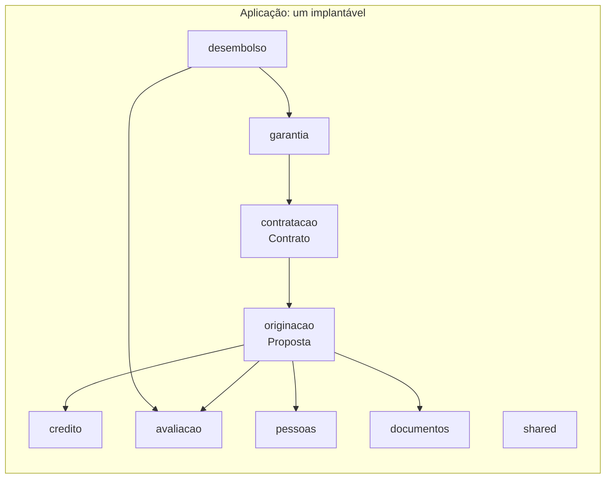
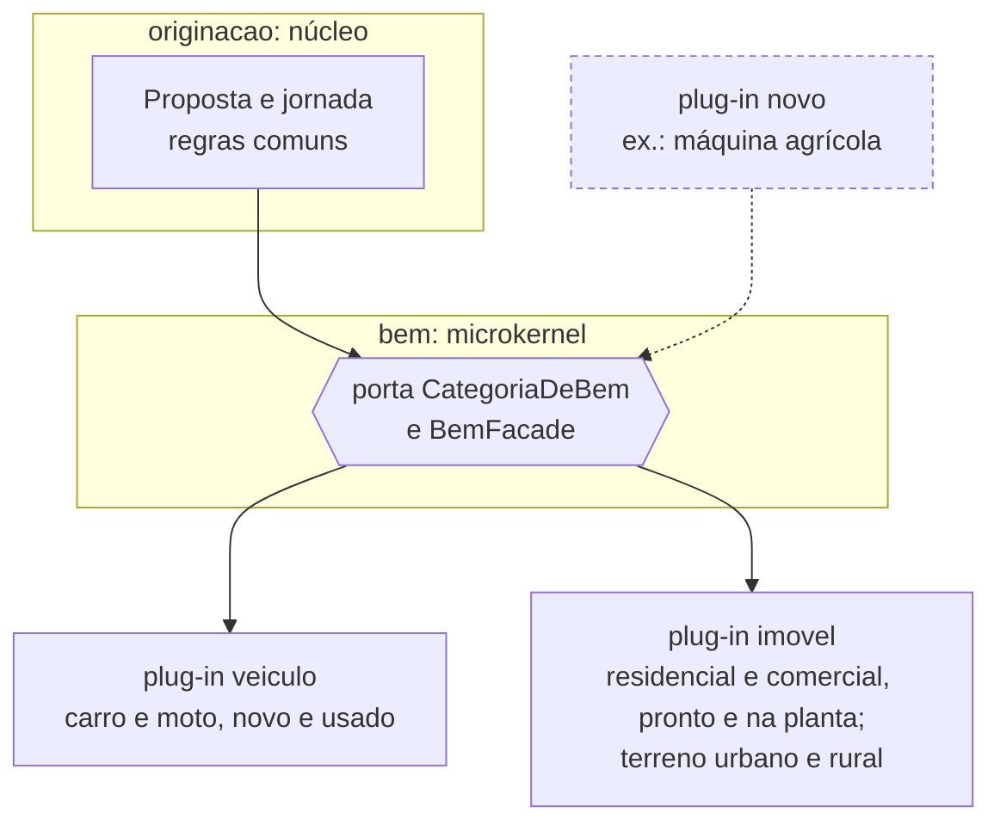
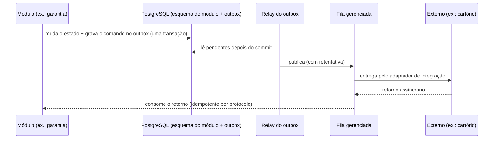

# Arquitetura do sistema de financiamento de bens

Espaço da solução. As definições de negócio estão aprovadas em [`../dominio`](../dominio/README.md) (snapshot v2).
As decisões abaixo seguem o método de Mark Richards (*Fundamentals of Software Architecture* e *Software
Architecture: The Hard Parts*):
1. características de arquitetura tiradas dos motivos de negócio, das quais **três dirigem** o desenho;
2. quanta de arquitetura;
3. estilo escolhido pela comparação com as características;
4. dados e comunicação;
5. cada decisão registrada num [ADR](adr/) e protegida por fitness functions.

## 1. Características de arquitetura

| Motivo de negócio | Característica |
|---|---|
| O sistema é um **modelo para vários projetos**, e cada um vai adaptar regras, prazos e jornada | **Evolutividade** |
| O que varia por **tipo de bem** (prazo, cota, documentos, avaliação, registro) não pode espalhar `if` pelo núcleo; novos tipos devem entrar sem mexer nele | **Extensibilidade** |
| Lida com **dinheiro e garantias**: uma proposta, um contrato ou um retorno de cartório não pode se perder, e uma liberação nunca pode ser duplicada | **Confiabilidade** |

Essas três **dirigem** a arquitetura ([ADR 0001](adr/0001-caracteristicas-de-arquitetura.md)). As demais valem, mas como
**implícitas**: são atendidas pelo desenho de qualquer estilo e não decidem a escolha.
- **Disponibilidade:** canais 24x7. Com volume baixo, réplicas de um implantável bastam.
- **Testabilidade:** regras isoladas no domínio; externos simulados.
- **Auditabilidade:** toda decisão registrada com motivo e responsável.
- **Segurança:** acesso por perfil.
- **Interoperabilidade:** camada anticorrupção por sistema externo.

**Contexto:** volume baixo (~1 mil propostas por mês, dezenas de usuários simultâneos), 1 time pequeno (3 a 8 pessoas),
operação em containers/Kubernetes.

## 2. Quanta

**Um quantum** ([ADR 0002](adr/0002-um-quantum.md)). Nenhuma parte do sistema precisa de características diferentes
das outras. Separar traria custo de rede, de consistência distribuída e de operação para 1 time, sem ganho para as
três características que dirigem. Os retornos assíncronos dos externos entram por fila durável, e não por um
quantum próprio.

## 3. Estilo: monólito modular com microkernel

Comparação dos estilos de Richards com as três características (escala de 1 a 5, adaptada ao contexto de 1 time e
volume baixo; o custo e a simplicidade pesam como desempate):

| Estilo | Evolutividade | Extensibilidade | Confiabilidade | Custo / simplicidade |
|---|:-:|:-:|:-:|:-:|
| Em camadas | 1 | 1 | 3 | 5 |
| **Monólito modular** | **3** | **2** | **4** | **5** |
| **Microkernel** | 3 | **5** | 3 | 4 |
| Baseado em serviços | 4 | 2 | 4 | 3 |
| Orientado a eventos | 4 | 4 | 3 | 2 |
| Microsserviços | 5 | 4 | 4 | 1 |

Nenhum estilo sozinho cobre as três. A combinação **monólito modular + microkernel** cobre
([ADR 0003](adr/0003-monolito-modular-com-microkernel.md)):
- **Módulos por domínio** dão a evolutividade: fronteiras claras, cada módulo dono dos seus dados.
- **Microkernel por categoria de bem** dá a extensibilidade: o núcleo da originação não conhece veículo nem imóvel, e um tipo novo é um plug-in novo.
- **Um implantável com transação local** dá a confiabilidade: sem transação distribuída.

### Módulos

Cada domínio do modelo aprovado é um módulo, todos no mesmo implantável:

| Módulo | Domínio no modelo | Classificação | Agregado |
|---|---|---|---|
| `originacao` | DOM-0001 Originação | Principal | AGR-0001 Proposta |
| `credito` | DOM-0002 Crédito | Suporte | — |
| `avaliacao` | DOM-0003 Avaliação | Suporte | — |
| `contratacao` | DOM-0004 Contratação | Suporte | AGR-0002 Contrato |
| `garantia` | DOM-0005 Garantia | Suporte | — |
| `desembolso` | DOM-0006 Desembolso | Suporte | — |
| `pessoas` | DOM-0007 Cadastro de pessoas | Genérico | — |
| `documentos` | DOM-0008 Documentos | Genérico | — |

As setas são as dependências do mapa de contexto do modelo (`DEPENDE_DE`).

**Organização interna de cada módulo:** segue a skill `arquitetura-modular` já usada nos projetos.
- pastas técnicas `dominio/`, `aplicacao/`, `entrypoint/` e `integracao/`;
- uma `Facade` na raiz, única porta de entrada para os outros módulos;
- referência por ID entre módulos, sem associação JPA entre eles;
- interfaces (ports) só para sistemas externos e para variação real, que são os plug-ins.

### Microkernel: plug-ins por categoria de bem

Cada plug-in responde, para a sua categoria:
- o enquadramento: prazos, cota máxima, idade, restrições;
- os documentos exigidos;
- a fonte e a validade da avaliação;
- os seguros exigidos;
- o órgão de registro da garantia;
- a forma de liberação: única ou por medição.

Os valores vêm das regras parametrizadas pela dimensão **"Tipo de bem"** do modelo (DIM-0001). Terreno é subtipo de imóvel, como no modelo.

**No código**, a porta e os plug-ins ficam no pacote `bem`:
- a raiz tem a porta `CategoriaDeBem`, os objetos de valor (`TipoDeBem`, `ParametrosDoTipo`, ...) e a `BemFacade`, que acha o plug-in pelo CDI;
- `bem/veiculo` e `bem/imovel` são os plug-ins, package-private.

Assim, a regra "outro módulo só pela raiz" já impede o núcleo e os outros módulos de conhecerem um plug-in. É o desenho do [ADR 0003](adr/0003-monolito-modular-com-microkernel.md), com a porta num pacote próprio para que garantia, desembolso e contratação a consultem sem depender da originação.

### Núcleo implementado: originação

Primeiro passo do código: o agregado Proposta, o ciclo de vida e o enquadramento, com os dois plug-ins.

| Modelo de negócio | Código |
|---|---|
| AGR-0001 Proposta e invariantes | `originacao/dominio/Proposta` |
| CV-0001 Ciclo de vida da proposta | `originacao/dominio/EstadoProposta`, conferido contra o diagrama do modelo |
| RN-0001 a RN-0009, RN-0015, RN-0018 e RN-0033 | `originacao/dominio/RegrasDeEnquadramento` |
| RN-0010, RN-0016, RN-0017 e RN-0020 por tipo | `bem/veiculo/Veiculo` e `bem/imovel/Imovel`, conferidos contra a tabela RN-0010 do modelo |
| RN-0011 | plug-in `veiculo` |
| RN-0012 e RN-0014 | plug-in `imovel` |
| UC-0001 a UC-0005 e UC-0010 | `originacao/aplicacao/*Service` e API web `/web/propostas` |
| EVT-0001, EVT-0002 e EVT-0007 | gravados no outbox (`shared.outbox`) na transação do caso de uso |

**Próximos passos:**
- decisão, contraproposta, pendência e expiração (UC-0006 a UC-0009), que dependem de Crédito e Avaliação;
- RN-0013 e a elegibilidade do FGTS, que dependem de sistemas externos;
- o relay do outbox para a fila.

## 4. Dados e comunicação

- **PostgreSQL**, um banco com **um esquema por módulo** ([ADR 0004](adr/0004-postgresql-com-esquema-por-modulo.md)).
  - Cada módulo é dono das suas tabelas; os outros só chegam a elas pela fachada.
  - A transação é local.
  - O módulo pode ser extraído depois sem desmontar dados compartilhados.
- **Comunicação** ([ADR 0005](adr/0005-comunicacao-sincrona-interna-e-outbox.md) e [ADR 0006](adr/0006-mensageria-por-fila-gerenciada.md)):
  - **Entre módulos:** chamada síncrona pela fachada, na mesma transação.
  - **Para os externos:** o comando é gravado no **outbox**, na mesma transação da mudança de estado. Um relay publica na **fila gerenciada** depois do commit, com retentativa.
  - **Retornos:** entram pela fila e são **idempotentes**. Um protocolo repetido não tem novo efeito, como pede a regra de negócio "retorno de registro é fato, não pedido".

Os 6 sistemas externos do modelo têm cada um uma camada anticorrupção no módulo dono: bureau (`credito`), avaliador (`avaliacao`), seguradora (`contratacao`), cartório e órgão de trânsito (`garantia`) e FGTS (`desembolso`).

## 5. Stack e governança

- **Java 25 + Quarkus 3.33** ([ADR 0007](adr/0007-java-25-e-quarkus-3-33.md)): a versão usada é a 3.33.3, porque não houve 3.33.0 publicada.
- **Fitness functions** ([ADR 0008](adr/0008-fitness-functions.md)), rodando em todo `./mvnw verify`, em `src/test/java/br/com/financiamento/arquitetura/`:
  - `ArquiteturaTest`, as fronteiras de módulo com as regras da skill `arquitetura-modular`;
  - `PluginsDeTipoDeBemTest`:
    - ninguém fora de um plug-in depende dele;
    - cada tipo de bem final de DIM-0001, lido de `docs/dominio/especificacao.md`, tem exatamente um plug-in;
    - os parâmetros conferem com a tabela RN-0010;
  - `EsquemaPorModuloTest`: entidades, migrações e consultas só no esquema do próprio módulo.

## ADRs

| # | Decisão | Atende |
|---|---|---|
| [0001](adr/0001-caracteristicas-de-arquitetura.md) | Evolutividade, extensibilidade e confiabilidade dirigem a arquitetura | — |
| [0002](adr/0002-um-quantum.md) | Um quantum | confiabilidade |
| [0003](adr/0003-monolito-modular-com-microkernel.md) | Monólito modular com microkernel por categoria de bem | as três |
| [0004](adr/0004-postgresql-com-esquema-por-modulo.md) | PostgreSQL com um esquema por módulo | evolutividade, confiabilidade |
| [0005](adr/0005-comunicacao-sincrona-interna-e-outbox.md) | Comunicação síncrona entre módulos e outbox para fora | confiabilidade |
| [0006](adr/0006-mensageria-por-fila-gerenciada.md) | Fila gerenciada atrás de uma porta: RabbitMQ padrão, SQS alternativa | confiabilidade, evolutividade |
| [0007](adr/0007-java-25-e-quarkus-3-33.md) | Java 25 e Quarkus 3.33 | evolutividade |
| [0008](adr/0008-fitness-functions.md) | Fitness functions para as decisões estruturais | as três |
