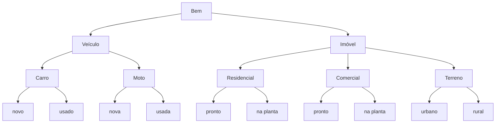
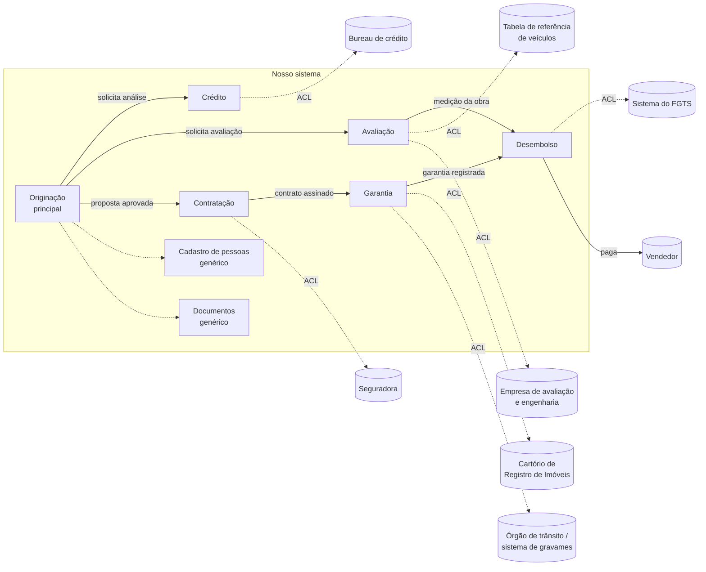
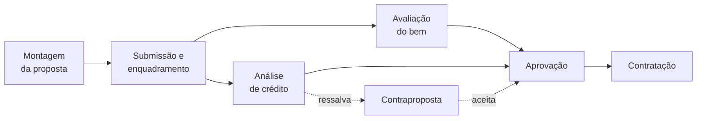
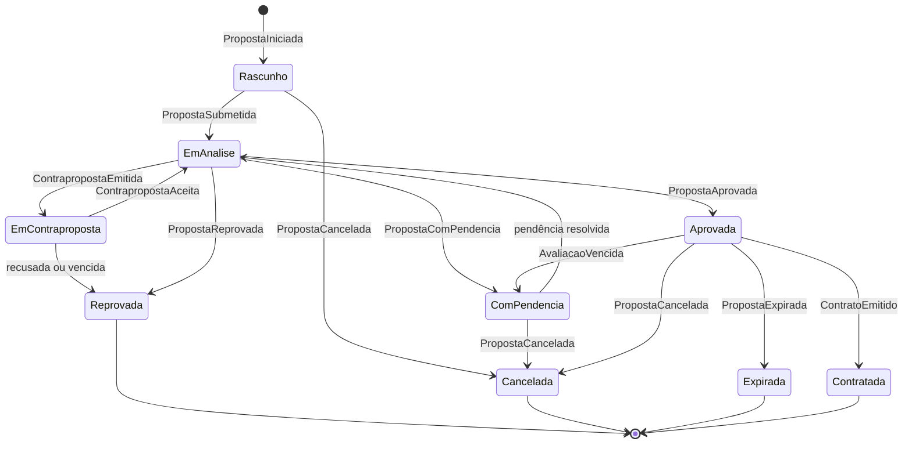
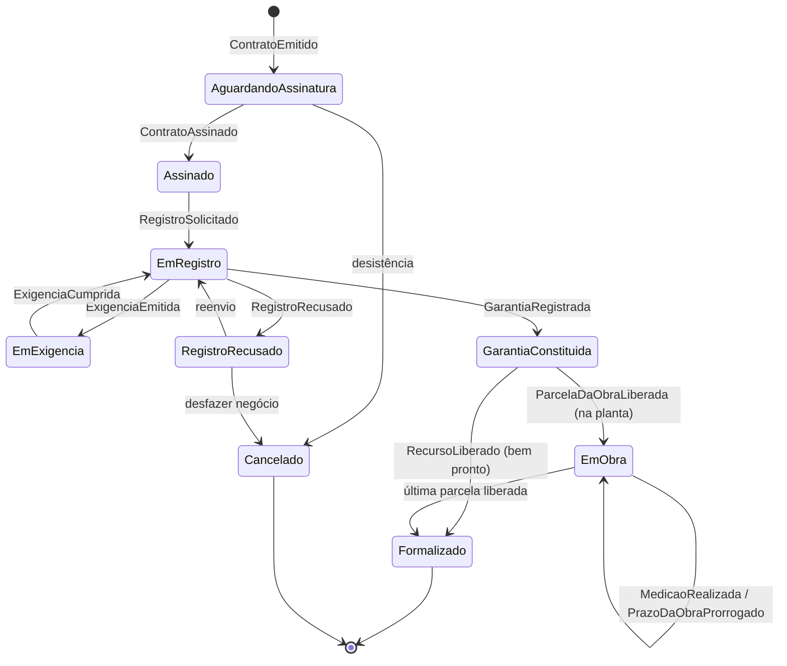

# Sistema de Financiamento de Bens

## Índice

- 1.1 [DOC-0001 - Glossário](#doc-0001)
  - 1.1.1 [S-0001 - Pessoas](#s-0001)
    - 1.1.1.1 [GLO-0001 - Participante](#glo-0001)
    - 1.1.1.2 [GLO-0002 - Pessoa física](#glo-0002)
    - 1.1.1.3 [GLO-0003 - Pessoa jurídica](#glo-0003)
    - 1.1.1.4 [GLO-0004 - Renda comprovada](#glo-0004)
    - 1.1.1.5 [GLO-0005 - Incorporadora](#glo-0005)
  - 1.1.2 [S-0002 - Bem](#s-0002)
    - 1.1.2.1 [GLO-0006 - Bem](#glo-0006)
    - 1.1.2.2 [GLO-0007 - Categoria](#glo-0007)
    - 1.1.2.3 [GLO-0008 - Subtipo](#glo-0008)
    - 1.1.2.4 [GLO-0009 - Condição do bem](#glo-0009)
    - 1.1.2.5 [GLO-0010 - Imóvel na planta](#glo-0010)
    - 1.1.2.6 [GLO-0011 - Terreno rural](#glo-0011)
    - 1.1.2.7 [GLO-0012 - Identificação do bem](#glo-0012)
    - 1.1.2.8 [GLO-0013 - Valor de compra](#glo-0013)
    - 1.1.2.9 [GLO-0014 - Valor de avaliação](#glo-0014)
    - 1.1.2.10 [GLO-0015 - Valor de referência](#glo-0015)
    - 1.1.2.11 [GLO-0016 - Ano-modelo](#glo-0016)
    - 1.1.2.12 [GLO-0017 - Laudo de avaliação](#glo-0017)
    - 1.1.2.13 [GLO-0018 - Vistoria do veículo](#glo-0018)
    - 1.1.2.14 [GLO-0019 - Medição da obra](#glo-0019)
    - 1.1.2.15 [GLO-0020 - Validade da avaliação](#glo-0020)
  - 1.1.3 [S-0003 - Condições](#s-0003)
    - 1.1.3.1 [GLO-0021 - Entrada](#glo-0021)
    - 1.1.3.2 [GLO-0022 - Recurso do FGTS](#glo-0022)
    - 1.1.3.3 [GLO-0023 - Valor financiado](#glo-0023)
    - 1.1.3.4 [GLO-0024 - Cota de financiamento](#glo-0024)
    - 1.1.3.5 [GLO-0025 - Prazo](#glo-0025)
    - 1.1.3.6 [GLO-0026 - Parcela](#glo-0026)
    - 1.1.3.7 [GLO-0027 - Comprometimento de renda](#glo-0027)
    - 1.1.3.8 [GLO-0028 - Condições do financiamento](#glo-0028)
    - 1.1.3.9 [GLO-0029 - Seguro exigido](#glo-0029)
    - 1.1.3.10 [GLO-0030 - MIP](#glo-0030)
    - 1.1.3.11 [GLO-0031 - DFI](#glo-0031)
  - 1.1.4 [S-0004 - Jornada](#s-0004)
    - 1.1.4.1 [GLO-0032 - Proposta](#glo-0032)
    - 1.1.4.2 [GLO-0033 - Enquadramento](#glo-0033)
    - 1.1.4.3 [GLO-0034 - Submissão](#glo-0034)
    - 1.1.4.4 [GLO-0035 - Análise de crédito](#glo-0035)
    - 1.1.4.5 [GLO-0036 - Ressalva](#glo-0036)
    - 1.1.4.6 [GLO-0037 - Contraproposta](#glo-0037)
    - 1.1.4.7 [GLO-0038 - Pendência](#glo-0038)
    - 1.1.4.8 [GLO-0039 - Exigência](#glo-0039)
    - 1.1.4.9 [GLO-0040 - Contrato](#glo-0040)
    - 1.1.4.10 [GLO-0041 - Alienação fiduciária](#glo-0041)
    - 1.1.4.11 [GLO-0042 - Gravame](#glo-0042)
    - 1.1.4.12 [GLO-0043 - Registro da garantia](#glo-0043)
    - 1.1.4.13 [GLO-0044 - Liberação do recurso](#glo-0044)
    - 1.1.4.14 [GLO-0045 - Prorrogação da obra](#glo-0045)
- 1.2 [DOC-0002 - Atores](#doc-0002)
  - 1.2.1 [ATR-0001 - Proponente](#atr-0001)
  - 1.2.2 [ATR-0002 - Coobrigado](#atr-0002)
  - 1.2.3 [ATR-0003 - Vendedor](#atr-0003)
  - 1.2.4 [ATR-0004 - Correspondente](#atr-0004)
  - 1.2.5 [ATR-0005 - Analista](#atr-0005)
  - 1.2.6 [ATR-0006 - Engenheiro de medição](#atr-0006)
  - 1.2.7 [ATR-0007 - Avaliador](#atr-0007)
  - 1.2.8 [ATR-0008 - Bureau de crédito](#atr-0008)
  - 1.2.9 [ATR-0009 - Cartório de Registro de Imóveis](#atr-0009)
  - 1.2.10 [ATR-0010 - Órgão de trânsito](#atr-0010)
  - 1.2.11 [ATR-0011 - Seguradora](#atr-0011)
  - 1.2.12 [ATR-0012 - Sistema do FGTS](#atr-0012)
- 1.3 [DOC-0003 - Questões em aberto](#doc-0003)
  - 1.3.1 [Q-0001 - O proponente pode ser pessoa jurídica?](#q-0001)
  - 1.3.2 [Q-0002 - A proposta aceita coobrigado? Quantos?](#q-0002)
  - 1.3.3 [Q-0003 - Quem pode vender veículo?](#q-0003)
  - 1.3.4 [Q-0004 - Imóvel na planta entra no modelo?](#q-0004)
  - 1.3.5 [Q-0005 - Terreno é subtipo de imóvel ou categoria própria?](#q-0005)
  - 1.3.6 [Q-0006 - Terreno rural entra no modelo?](#q-0006)
  - 1.3.7 [Q-0007 - Libera o dinheiro com o gravame só solicitado?](#q-0007)
  - 1.3.8 [Q-0008 - Seguros obrigatórios entram no modelo?](#q-0008)
  - 1.3.9 [Q-0009 - Quem pode iniciar uma proposta?](#q-0009)
  - 1.3.10 [Q-0010 - O que acontece com a aprovação com ressalva?](#q-0010)
  - 1.3.11 [Q-0011 - A entrada do imóvel pode usar FGTS ou subsídio?](#q-0011)
  - 1.3.12 [Q-0012 - O mesmo bem pode estar em mais de uma proposta ativa?](#q-0012)
  - 1.3.13 [Q-0013 - A avaliação do bem tem validade?](#q-0013)
  - 1.3.14 [Q-0014 - Qual o limite de prorrogações da obra?](#q-0014)
  - 1.3.15 [Q-0015 - Qual o prazo de validade da contraproposta?](#q-0015)
  - 1.3.16 [Q-0016 - Qual a validade exata da avaliação em cada categoria?](#q-0016)
  - 1.3.17 [Q-0017 - Quais documentos são exigidos de participante pessoa jurídica?](#q-0017)
- 1.4 [DOC-0004 - Decisões](#doc-0004)
  - 1.4.1 [DEC-0001 - Pessoa jurídica só em carro novo, moto nova e imóvel comercial](#dec-0001)
  - 1.4.2 [DEC-0002 - Até 4 coobrigados; em proposta de PJ, coobrigado PF ou PJ](#dec-0002)
  - 1.4.3 [DEC-0003 - Proponente, vendedor e correspondente iniciam a proposta](#dec-0003)
  - 1.4.4 [DEC-0004 - Vendedor de veículo pode ser loja ou particular](#dec-0004)
  - 1.4.5 [DEC-0005 - Na planta é condição do imóvel residencial e comercial](#dec-0005)
  - 1.4.6 [DEC-0006 - Liberação da planta por medição, com prorrogação limitada](#dec-0006)
  - 1.4.7 [DEC-0007 - Terreno é subtipo de imóvel, urbano e rural](#dec-0007)
  - 1.4.8 [DEC-0008 - Nenhuma liberação sem garantia confirmada](#dec-0008)
  - 1.4.9 [DEC-0009 - Ressalva vira contraproposta com validade](#dec-0009)
  - 1.4.10 [DEC-0010 - Um bem em no máximo uma proposta ativa](#dec-0010)
  - 1.4.11 [DEC-0011 - A avaliação tem validade por categoria](#dec-0011)
  - 1.4.12 [DEC-0012 - Seguros entram como exigência, sem cálculo](#dec-0012)
  - 1.4.13 [DEC-0013 - FGTS na entrada só no imóvel residencial de pessoa física](#dec-0013)
- 1.5 [DOM-0001 - Originação](#dom-0001)
  - 1.5.1 [VIS-0001 - Visão do Domínio](#vis-0001)
  - 1.5.2 [AGR-0001 - Proposta](#agr-0001)
  - 1.5.3 [CV-0001 - Ciclo de vida da proposta](#cv-0001)
  - 1.5.4 [S-0005 - Eventos](#s-0005)
    - 1.5.4.1 [EVT-0001 - PropostaIniciada](#evt-0001)
    - 1.5.4.2 [EVT-0002 - PropostaSubmetida](#evt-0002)
    - 1.5.4.3 [EVT-0003 - PropostaComPendencia](#evt-0003)
    - 1.5.4.4 [EVT-0004 - PropostaAprovada](#evt-0004)
    - 1.5.4.5 [EVT-0005 - PropostaReprovada](#evt-0005)
    - 1.5.4.6 [EVT-0006 - PropostaCancelada](#evt-0006)
    - 1.5.4.7 [EVT-0007 - PropostaExpirada](#evt-0007)
    - 1.5.4.8 [EVT-0008 - ContrapropostaEmitida](#evt-0008)
    - 1.5.4.9 [EVT-0009 - ContrapropostaAceita](#evt-0009)
    - 1.5.4.10 [EVT-0010 - ContrapropostaRecusada](#evt-0010)
  - 1.5.5 [DOC-0005 - Regras de Negócio](#doc-0005)
    - 1.5.5.1 [S-0006 - Regras comuns](#s-0006)
      - 1.5.5.1.1 [RN-0001 - Participantes da proposta](#rn-0001)
      - 1.5.5.1.2 [RN-0002 - Pessoa jurídica como proponente](#rn-0002)
      - 1.5.5.1.3 [RN-0003 - Vendedor identificado](#rn-0003)
      - 1.5.5.1.4 [RN-0004 - Bem em uma só proposta ativa](#rn-0004)
      - 1.5.5.1.5 [RN-0005 - Valor financiado](#rn-0005)
      - 1.5.5.1.6 [RN-0006 - Limite da cota de financiamento](#rn-0006)
      - 1.5.5.1.7 [RN-0007 - Prazo dentro da faixa do tipo](#rn-0007)
      - 1.5.5.1.8 [RN-0008 - Comprometimento de renda](#rn-0008)
      - 1.5.5.1.9 [RN-0009 - Documentos obrigatórios](#rn-0009)
    - 1.5.5.2 [S-0007 - Regras por tipo de bem](#s-0007)
      - 1.5.5.2.1 [RN-0010 - Parâmetros por tipo de bem](#rn-0010)
      - 1.5.5.2.2 [RN-0011 - Idade máxima do veículo usado](#rn-0011)
      - 1.5.5.2.3 [RN-0012 - Idade do proponente no imóvel](#rn-0012)
      - 1.5.5.2.4 [RN-0013 - Veículo usado sem restrição](#rn-0013)
      - 1.5.5.2.5 [RN-0014 - Terreno sem construção](#rn-0014)
      - 1.5.5.2.6 [RN-0015 - Uso do FGTS na entrada](#rn-0015)
      - 1.5.5.2.7 [RN-0016 - Documentos por tipo de bem](#rn-0016)
    - 1.5.5.3 [S-0008 - Regras da jornada](#s-0008)
      - 1.5.5.3.1 [RN-0017 - Enquadramento para submeter](#rn-0017)
      - 1.5.5.3.2 [RN-0018 - Aprovação da proposta](#rn-0018)
      - 1.5.5.3.3 [RN-0019 - Contraproposta](#rn-0019)
      - 1.5.5.3.4 [RN-0020 - Validade da proposta aprovada](#rn-0020)
      - 1.5.5.3.5 [RN-0021 - Avaliação válida para contratar](#rn-0021)
  - 1.5.6 [S-0009 - Casos de uso](#s-0009)
    - 1.5.6.1 [UC-0001 - Iniciar proposta](#uc-0001)
    - 1.5.6.2 [UC-0002 - Informar participantes](#uc-0002)
    - 1.5.6.3 [UC-0003 - Informar bem e vendedor](#uc-0003)
    - 1.5.6.4 [UC-0004 - Simular e escolher condições](#uc-0004)
    - 1.5.6.5 [UC-0005 - Submeter proposta](#uc-0005)
    - 1.5.6.6 [UC-0006 - Responder contraproposta](#uc-0006)
    - 1.5.6.7 [UC-0007 - Cancelar proposta](#uc-0007)
- 1.6 [DOM-0002 - Crédito](#dom-0002)
  - 1.6.1 [VIS-0002 - Visão do Domínio](#vis-0002)
  - 1.6.2 [S-0010 - Eventos](#s-0010)
    - 1.6.2.1 [EVT-0011 - AnaliseCreditoSolicitada](#evt-0011)
    - 1.6.2.2 [EVT-0012 - CreditoAprovado](#evt-0012)
    - 1.6.2.3 [EVT-0013 - CreditoAprovadoComRessalva](#evt-0013)
    - 1.6.2.4 [EVT-0014 - CreditoReprovado](#evt-0014)
  - 1.6.3 [S-0011 - Casos de uso](#s-0011)
    - 1.6.3.1 [UC-0008 - Analisar crédito](#uc-0008)
- 1.7 [DOM-0003 - Avaliação](#dom-0003)
  - 1.7.1 [VIS-0003 - Visão do Domínio](#vis-0003)
  - 1.7.2 [S-0012 - Eventos](#s-0012)
    - 1.7.2.1 [EVT-0015 - AvaliacaoSolicitada](#evt-0015)
    - 1.7.2.2 [EVT-0016 - BemAvaliado](#evt-0016)
    - 1.7.2.3 [EVT-0017 - BemRecusadoComoGarantia](#evt-0017)
    - 1.7.2.4 [EVT-0018 - AvaliacaoVencida](#evt-0018)
    - 1.7.2.5 [EVT-0019 - MedicaoRealizada](#evt-0019)
  - 1.7.3 [DOC-0006 - Regras de Negócio](#doc-0006)
    - 1.7.3.1 [RN-0022 - Fonte da avaliação por tipo de bem](#rn-0022)
    - 1.7.3.2 [RN-0023 - Medição da obra](#rn-0023)
  - 1.7.4 [S-0013 - Casos de uso](#s-0013)
    - 1.7.4.1 [UC-0009 - Avaliar bem](#uc-0009)
    - 1.7.4.2 [UC-0010 - Medir obra](#uc-0010)
- 1.8 [DOM-0004 - Contratação](#dom-0004)
  - 1.8.1 [VIS-0004 - Visão do Domínio](#vis-0004)
  - 1.8.2 [AGR-0002 - Contrato](#agr-0002)
  - 1.8.3 [CV-0002 - Ciclo de vida do contrato](#cv-0002)
  - 1.8.4 [S-0014 - Eventos](#s-0014)
    - 1.8.4.1 [EVT-0020 - CondicoesAceitas](#evt-0020)
    - 1.8.4.2 [EVT-0021 - SegurosContratados](#evt-0021)
    - 1.8.4.3 [EVT-0022 - ContratoEmitido](#evt-0022)
    - 1.8.4.4 [EVT-0023 - ContratoAssinado](#evt-0023)
    - 1.8.4.5 [EVT-0024 - PrazoDaObraProrrogado](#evt-0024)
  - 1.8.5 [DOC-0007 - Regras de Negócio](#doc-0007)
    - 1.8.5.1 [RN-0024 - Seguros exigidos por tipo de bem](#rn-0024)
    - 1.8.5.2 [RN-0025 - Assinaturas exigidas](#rn-0025)
    - 1.8.5.3 [RN-0026 - Prorrogação do prazo da obra](#rn-0026)
  - 1.8.6 [S-0015 - Casos de uso](#s-0015)
    - 1.8.6.1 [UC-0011 - Emitir contrato](#uc-0011)
    - 1.8.6.2 [UC-0012 - Assinar contrato](#uc-0012)
    - 1.8.6.3 [UC-0013 - Prorrogar prazo da obra](#uc-0013)
- 1.9 [DOM-0005 - Garantia](#dom-0005)
  - 1.9.1 [VIS-0005 - Visão do Domínio](#vis-0005)
  - 1.9.2 [S-0016 - Eventos](#s-0016)
    - 1.9.2.1 [EVT-0025 - RegistroSolicitado](#evt-0025)
    - 1.9.2.2 [EVT-0026 - GarantiaRegistrada](#evt-0026)
    - 1.9.2.3 [EVT-0027 - ExigenciaEmitida](#evt-0027)
    - 1.9.2.4 [EVT-0028 - ExigenciaCumprida](#evt-0028)
    - 1.9.2.5 [EVT-0029 - RegistroRecusado](#evt-0029)
  - 1.9.3 [DOC-0008 - Regras de Negócio](#doc-0008)
    - 1.9.3.1 [RN-0027 - Órgão de registro por categoria](#rn-0027)
    - 1.9.3.2 [RN-0028 - Retorno de registro é fato, não pedido](#rn-0028)
  - 1.9.4 [S-0017 - Casos de uso](#s-0017)
    - 1.9.4.1 [UC-0014 - Registrar garantia](#uc-0014)
    - 1.9.4.2 [UC-0015 - Cumprir exigência](#uc-0015)
- 1.10 [DOM-0006 - Desembolso](#dom-0006)
  - 1.10.1 [VIS-0006 - Visão do Domínio](#vis-0006)
  - 1.10.2 [S-0018 - Eventos](#s-0018)
    - 1.10.2.1 [EVT-0030 - LiberacaoSolicitada](#evt-0030)
    - 1.10.2.2 [EVT-0031 - RecursoLiberado](#evt-0031)
    - 1.10.2.3 [EVT-0032 - ParcelaDaObraLiberada](#evt-0032)
    - 1.10.2.4 [EVT-0033 - FgtsSolicitado](#evt-0033)
    - 1.10.2.5 [EVT-0034 - FgtsLiberado](#evt-0034)
    - 1.10.2.6 [EVT-0035 - FgtsNegado](#evt-0035)
  - 1.10.3 [DOC-0009 - Regras de Negócio](#doc-0009)
    - 1.10.3.1 [RN-0029 - Nenhuma liberação sem garantia confirmada](#rn-0029)
    - 1.10.3.2 [RN-0030 - Soma das liberações](#rn-0030)
    - 1.10.3.3 [RN-0031 - Liberação por medição](#rn-0031)
  - 1.10.4 [S-0019 - Casos de uso](#s-0019)
    - 1.10.4.1 [UC-0016 - Liberar recurso](#uc-0016)
    - 1.10.4.2 [UC-0017 - Liberar parcela da obra](#uc-0017)
- 1.11 [DOM-0007 - Cadastro de pessoas](#dom-0007)
  - 1.11.1 [VIS-0007 - Visão do Domínio](#vis-0007)
- 1.12 [DOM-0008 - Documentos](#dom-0008)
  - 1.12.1 [VIS-0008 - Visão do Domínio](#vis-0008)

---

# 1 P-0001 - Sistema de Financiamento de Bens

Modelo de domínio de um **sistema-modelo de financiamento de bens**, reaproveitável em vários projetos.
Cobre a jornada da **proposta** até o **contrato formalizado**, com a garantia registrada e o dinheiro
liberado ao vendedor. Esta etapa fica no **espaço do problema**: não há arquitetura, tecnologia nem banco.

## Bens financiados

| Categoria | Subtipo | Condição | Aceita proponente PJ |
|---|---|---|---|
| Veículo | carro | novo | sim |
| Veículo | carro | usado | não |
| Veículo | moto | nova | sim |
| Veículo | moto | usada | não |
| Imóvel | residencial | pronto ou na planta | não |
| Imóvel | comercial | pronto ou na planta | sim |
| Imóvel | terreno (urbano ou rural) | — | não |

O que se repete em todos os tipos é a **jornada**. O que varia é a **regra**: prazo, quanto pode ser
financiado, documentos, avaliação, seguros e onde a garantia é registrada.

## Mapa de contexto

ACL é a camada anticorrupção: códigos e formatos de sistemas externos não entram no modelo. Os retornos
externos são **assíncronos** e podem chegar repetidos ou fora de ordem.

## Fora de escopo nesta etapa

- Vida do contrato depois de formalizado: cobrança, atraso, renegociação, quitação.
- Cálculo financeiro (taxa, CET, PRICE/SAC) e cálculo de prêmio de seguro: a parcela é um dado da simulação.
- Subsídio habitacional, consórcio, leasing e refinanciamento.

> Os números das regras são **hipotéticos e parametrizáveis**: cada projeto ajusta os seus.

## 1.1 DOC-0001 - Glossário

Linguagem ubíqua: cada termo tem um só nome e um só significado em conversas, documentos e código.

### Termos a evitar

| Evite | Use | Por quê |
|---|---|---|
| pedido, solicitação, operação | proposta (antes do contrato) ou contrato (depois) | são fases diferentes, com regras diferentes |
| cliente | proponente, coobrigado, participante | "cliente" não diz o papel na dívida |
| aprovado, sem dizer o quê | crédito aprovado, garantia registrada, contrato formalizado | há várias aprovações independentes |
| valor do bem | valor de compra, valor de avaliação ou valor de referência | os três diferem e a regra usa o menor |

### 1.1.1 S-0001 - Pessoas

Quem participa da proposta e do contrato.

#### 1.1.1.1 GLO-0001 - Participante

Pessoa que integra a proposta: o proponente ou um coobrigado. Uma proposta tem de 1 a 5 participantes.

#### 1.1.1.2 GLO-0002 - Pessoa física

Participante identificado por CPF, com renda pessoal comprovada.

#### 1.1.1.3 GLO-0003 - Pessoa jurídica

Participante identificado por CNPJ (empresa), com faturamento comprovado. Só pode ser proponente em carro novo, moto nova e imóvel comercial.

#### 1.1.1.4 GLO-0004 - Renda comprovada

Renda mensal (PF) ou faturamento mensal (PJ) aceito após análise dos comprovantes. A da proposta é a soma da dos participantes.

#### 1.1.1.5 GLO-0005 - Incorporadora

Empresa que constrói e vende o imóvel na planta. É o vendedor nesse caso e recebe o dinheiro por medição da obra.

### 1.1.2 S-0002 - Bem

O objeto financiado e como ele é classificado e avaliado.

#### 1.1.2.1 GLO-0006 - Bem

Objeto comprado com o financiamento. É também a garantia do contrato.

#### 1.1.2.2 GLO-0007 - Categoria

Família do bem: Veículo ou Imóvel. Define a identificação do bem, a avaliação e onde a garantia é registrada.

#### 1.1.2.3 GLO-0008 - Subtipo

Especialização da categoria: carro e moto (veículo); residencial, comercial e terreno (imóvel). Define prazo, cota de financiamento e documentos.

#### 1.1.2.4 GLO-0009 - Condição do bem

Estado do bem dentro do subtipo: novo ou usado (veículo); pronto ou na planta (imóvel residencial e comercial). Terreno não tem condição.

#### 1.1.2.5 GLO-0010 - Imóvel na planta

Imóvel residencial ou comercial em construção, vendido pela incorporadora, com o dinheiro liberado conforme a obra avança.

#### 1.1.2.6 GLO-0011 - Terreno rural

Terreno fora do perímetro urbano, com documentos próprios: CCIR, ITR e CAR.

#### 1.1.2.7 GLO-0012 - Identificação do bem

Como o bem é reconhecido fora do sistema: chassi, placa e RENAVAM (veículo); matrícula e cartório (imóvel e terreno). Um bem só pode estar em uma proposta ativa.

#### 1.1.2.8 GLO-0013 - Valor de compra

Preço acordado entre comprador e vendedor.

#### 1.1.2.9 GLO-0014 - Valor de avaliação

Valor atribuído ao bem por fonte independente: laudo, tabela de referência ou nota fiscal do novo.

#### 1.1.2.10 GLO-0015 - Valor de referência

O menor entre o valor de compra e o valor de avaliação. Base do limite de financiamento.

#### 1.1.2.11 GLO-0016 - Ano-modelo

Ano de modelo do veículo; base da regra de idade máxima.

#### 1.1.2.12 GLO-0017 - Laudo de avaliação

Documento do avaliador credenciado sobre um imóvel ou terreno: valor, situação e aceitação como garantia.

#### 1.1.2.13 GLO-0018 - Vistoria do veículo

Inspeção do veículo usado vendido por particular: confere identificação, estado e que o vendedor é o dono.

#### 1.1.2.14 GLO-0019 - Medição da obra

Vistoria periódica de um engenheiro que apura o percentual executado da obra do imóvel na planta. Cada medição libera a parcela correspondente.

#### 1.1.2.15 GLO-0020 - Validade da avaliação

Prazo em que a avaliação vale para contratar. Varia por categoria; vencida, o bem é reavaliado.

### 1.1.3 S-0003 - Condições

Valores e prazos do financiamento.

#### 1.1.3.1 GLO-0021 - Entrada

Parte do valor de compra paga sem financiamento: recurso próprio e, no imóvel residencial de pessoa física, também FGTS.

#### 1.1.3.2 GLO-0022 - Recurso do FGTS

Parte da entrada paga com saldo do FGTS do proponente, liberado pelo sistema do FGTS diretamente ao vendedor.

#### 1.1.3.3 GLO-0023 - Valor financiado

Valor de compra menos a entrada. É o que o credor paga ao vendedor.

#### 1.1.3.4 GLO-0024 - Cota de financiamento

Valor financiado dividido pelo valor de referência (LTV). Cada tipo de bem tem um máximo.

#### 1.1.3.5 GLO-0025 - Prazo

Quantidade de parcelas mensais. Cada tipo de bem tem mínimo e máximo.

#### 1.1.3.6 GLO-0026 - Parcela

Valor mensal resultante da simulação. Nesta etapa é um dado: o cálculo fica fora do escopo.

#### 1.1.3.7 GLO-0027 - Comprometimento de renda

Parcela dividida pela renda comprovada da proposta. Tem um teto.

#### 1.1.3.8 GLO-0028 - Condições do financiamento

Conjunto de valor de compra, entrada (própria e FGTS), valor financiado, prazo e parcela.

#### 1.1.3.9 GLO-0029 - Seguro exigido

Seguro que o tipo de bem obriga a contratar antes do contrato: MIP, DFI ou seguro do bem. O prestamista é opcional.

#### 1.1.3.10 GLO-0030 - MIP

Seguro de morte e invalidez permanente: quita a dívida do imóvel ou terreno se o devedor morrer ou ficar inválido.

#### 1.1.3.11 GLO-0031 - DFI

Seguro de danos físicos ao imóvel construído (pronto ou na planta).

### 1.1.4 S-0004 - Jornada

Etapas e instrumentos da proposta ao contrato.

#### 1.1.4.1 GLO-0032 - Proposta

Pedido de financiamento de um bem por um ou mais participantes. Vai do rascunho até virar contrato ou ser encerrada.

#### 1.1.4.2 GLO-0033 - Enquadramento

Verificação de que a proposta respeita as regras do seu tipo de bem.

#### 1.1.4.3 GLO-0034 - Submissão

Momento em que a proposta completa e enquadrada segue para avaliação e análise de crédito. Antes disso é rascunho.

#### 1.1.4.4 GLO-0035 - Análise de crédito

Decisão sobre a capacidade e o histórico de pagamento dos participantes: aprovada, aprovada com ressalva ou reprovada.

#### 1.1.4.5 GLO-0036 - Ressalva

Aprovação de crédito condicionada a condições diferentes das pedidas (valor menor, entrada maior, prazo menor).

#### 1.1.4.6 GLO-0037 - Contraproposta

Nova versão das condições, emitida pelo credor a partir de uma ressalva. Tem validade; o proponente aceita ou recusa.

#### 1.1.4.7 GLO-0038 - Pendência

Algo que impede a proposta de seguir e pede ação de alguém (documento ilegível, avaliação vencida, cota estourada).

#### 1.1.4.8 GLO-0039 - Exigência

Pendência formal emitida pelo cartório ou pelo órgão de trânsito ao registrar a garantia.

#### 1.1.4.9 GLO-0040 - Contrato

Instrumento assinado que formaliza a dívida e a garantia. Nasce de uma proposta aprovada.

#### 1.1.4.10 GLO-0041 - Alienação fiduciária

Garantia em que o bem fica em nome do credor até a quitação; o devedor tem a posse.

#### 1.1.4.11 GLO-0042 - Gravame

Registro da alienação fiduciária do veículo no sistema nacional de gravames / órgão de trânsito.

#### 1.1.4.12 GLO-0043 - Registro da garantia

Averbação da alienação fiduciária na matrícula (imóvel e terreno) ou inclusão do gravame (veículo).

#### 1.1.4.13 GLO-0044 - Liberação do recurso

Pagamento do valor financiado ao vendedor. Única no bem pronto; por medição no imóvel na planta.

#### 1.1.4.14 GLO-0045 - Prorrogação da obra

Extensão do prazo previsto da obra do imóvel na planta, registrada no contrato até um limite.

## 1.2 DOC-0002 - Atores

Pessoas e sistemas que agem na jornada do financiamento.

### 1.2.1 ATR-0001 - Proponente

Quem pede o financiamento e se torna devedor. Pessoa física em todos os tipos; pessoa jurídica só em carro novo, moto nova e imóvel comercial.

### 1.2.2 ATR-0002 - Coobrigado

Compõe renda e responde junto pela dívida. Até 4 por proposta. Em proposta de pessoa jurídica, pode ser pessoa física (sócio, avalista) ou jurídica.

### 1.2.3 ATR-0003 - Vendedor

Quem vende o bem e recebe o dinheiro: concessionária, loja, particular (veículo), incorporadora (na planta) ou proprietário (imóvel pronto e terreno).

### 1.2.4 ATR-0004 - Correspondente

Correspondente bancário ou corretor que inicia e acompanha propostas em nome do proponente, com sua própria carteira.

### 1.2.5 ATR-0005 - Analista

Trata pendências, exigências e casos fora da alçada automática.

### 1.2.6 ATR-0006 - Engenheiro de medição

Vistoria a obra do imóvel na planta e apura o percentual executado.

### 1.2.7 ATR-0007 - Avaliador

Sistema ou empresa externa que define o valor de avaliação: laudo (imóvel e terreno) ou tabela de referência (veículo usado).

### 1.2.8 ATR-0008 - Bureau de crédito

Sistema externo que informa score, restrições e endividamento dos participantes.

### 1.2.9 ATR-0009 - Cartório de Registro de Imóveis

Registra a alienação fiduciária do imóvel ou terreno na matrícula. Pode emitir exigências.

### 1.2.10 ATR-0010 - Órgão de trânsito

Sistema de gravames e órgão de trânsito: incluem o gravame do veículo.

### 1.2.11 ATR-0011 - Seguradora

Emite os seguros exigidos pelo tipo de bem.

### 1.2.12 ATR-0012 - Sistema do FGTS

Decide a elegibilidade e libera o saldo de FGTS usado na entrada.

## 1.3 DOC-0003 - Questões em aberto

Perguntas de negócio que mudam o modelo. As respondidas apontam para a decisão; as abertas aguardam resposta.

### 1.3.1 Q-0001 - O proponente pode ser pessoa jurídica?

Define se o [participante](#glo-0001) tem duas formas e se a análise de crédito e os documentos variam.

### 1.3.2 Q-0002 - A proposta aceita coobrigado? Quantos?

Define a composição de renda e quem assina o contrato.

### 1.3.3 Q-0003 - Quem pode vender veículo?

Só loja e concessionária, ou também particular?

### 1.3.4 Q-0004 - Imóvel na planta entra no modelo?

Muda a liberação do recurso (em parcelas, por obra) e o ciclo de vida do contrato.

### 1.3.5 Q-0005 - Terreno é subtipo de imóvel ou categoria própria?

Define o reuso de identificação, avaliação e registro.

### 1.3.6 Q-0006 - Terreno rural entra no modelo?

O rural exige documentos próprios (CCIR, ITR, CAR).

### 1.3.7 Q-0007 - Libera o dinheiro com o gravame só solicitado?

No veículo novo, a concessionária só entrega o carro com o pagamento; o gravame é incluído no primeiro emplacamento.

### 1.3.8 Q-0008 - Seguros obrigatórios entram no modelo?

MIP e DFI no imóvel, prestamista e seguro do bem no veículo.

### 1.3.9 Q-0009 - Quem pode iniciar uma proposta?

Proponente, vendedor, correspondente?

### 1.3.10 Q-0010 - O que acontece com a aprovação com ressalva?

O proponente aceita no sistema, volta a rascunho ou recebe uma contraproposta?

### 1.3.11 Q-0011 - A entrada do imóvel pode usar FGTS ou subsídio?

Muda a composição da entrada e acrescenta um sistema externo.

### 1.3.12 Q-0012 - O mesmo bem pode estar em mais de uma proposta ativa?

Evita duas garantias sobre o mesmo bem.

### 1.3.13 Q-0013 - A avaliação do bem tem validade?

Se vencer antes da contratação, precisa ser refeita?

### 1.3.14 Q-0014 - Qual o limite de prorrogações da obra?

Quantidade de prorrogações ou meses acumulados aceitos antes de virar pendência para o analista.

### 1.3.15 Q-0015 - Qual o prazo de validade da contraproposta?

A sugestão inicial é 10 dias.

### 1.3.16 Q-0016 - Qual a validade exata da avaliação em cada categoria?

Sugestão inicial: laudo de imóvel e terreno 180 dias; tabela de referência do veículo usado, o mês da consulta; nota fiscal do novo, 30 dias.

### 1.3.17 Q-0017 - Quais documentos são exigidos de participante pessoa jurídica?

Contrato social, balanço, faturamento, procuração dos sócios?

## 1.4 DOC-0004 - Decisões

Decisões de negócio tomadas na entrevista de 2026-11-05 (registro completo em docs/definicoes).

### 1.4.1 DEC-0001 - Pessoa jurídica só em carro novo, moto nova e imóvel comercial

Responde [Q-0001](#q-0001).

Veículo usado, imóvel residencial e terreno: só [pessoa física](#glo-0002).

### 1.4.2 DEC-0002 - Até 4 coobrigados; em proposta de PJ, coobrigado PF ou PJ

Responde [Q-0002](#q-0002).

Uma proposta tem de 1 a 5 participantes. A renda da proposta é a soma da renda comprovada de todos.

### 1.4.3 DEC-0003 - Proponente, vendedor e correspondente iniciam a proposta

Responde [Q-0009](#q-0009).

O [ATR-0004](#atr-0004) passa a ser ator próprio, com sua carteira de propostas.

### 1.4.4 DEC-0004 - Vendedor de veículo pode ser loja ou particular

Responde [Q-0003](#q-0003).

Veículo usado vendido por particular exige [vistoria](#glo-0018) e conferência de que o vendedor é o dono.

### 1.4.5 DEC-0005 - Na planta é condição do imóvel residencial e comercial

Responde [Q-0004](#q-0004).

O imóvel ganha a condição pronto × na planta, como novo × usado no veículo. O vendedor do imóvel na planta é a [GLO-0005](#glo-0005). Terreno não tem condição.

### 1.4.6 DEC-0006 - Liberação da planta por medição, com prorrogação limitada

Responde [Q-0004](#q-0004).

Cada [medição](#glo-0019) libera a parcela correspondente ao avanço da obra; a garantia é registrada antes da primeira liberação. Atraso aceita prorrogação até um limite; acima dele vira pendência para o [ATR-0005](#atr-0005).

### 1.4.7 DEC-0007 - Terreno é subtipo de imóvel, urbano e rural

Responde [Q-0005](#q-0005) e [Q-0006](#q-0006).

Reaproveita matrícula, laudo e cartório. O rural tem documentos próprios.

### 1.4.8 DEC-0008 - Nenhuma liberação sem garantia confirmada

Responde [Q-0007](#q-0007).

Vale para todos os tipos de bem, inclusive o veículo novo.

### 1.4.9 DEC-0009 - Ressalva vira contraproposta com validade

Responde [Q-0010](#q-0010).

A [ressalva](#glo-0036) gera uma [contraproposta](#glo-0037). Aceita, a proposta segue com as novas condições; recusada ou vencida, é reprovada.

### 1.4.10 DEC-0010 - Um bem em no máximo uma proposta ativa

Responde [Q-0012](#q-0012).

A identificação do bem (chassi ou matrícula) é única entre propostas ativas.

### 1.4.11 DEC-0011 - A avaliação tem validade por categoria

Responde [Q-0013](#q-0013).

Vencida antes da contratação, a proposta fica com pendência e o bem é reavaliado.

### 1.4.12 DEC-0012 - Seguros entram como exigência, sem cálculo

Responde [Q-0008](#q-0008).

Imóvel pronto ou na planta: [MIP](#glo-0030) e [DFI](#glo-0031). Terreno: MIP. Veículo: seguro do bem. Prestamista opcional em todos. O prêmio não é calculado.

### 1.4.13 DEC-0013 - FGTS na entrada só no imóvel residencial de pessoa física

Responde [Q-0011](#q-0011).

Elegibilidade e saldo são decididos pelo [ATR-0012](#atr-0012). Sem subsídio habitacional.

## 1.5 DOM-0001 - Originação

**Classificação:** Principal

Monta a proposta, enquadra nas regras do tipo de bem e acompanha até virar contrato. É onde mora a variação entre os tipos de bem: o coração do modelo.

### 1.5.1 VIS-0001 - Visão do Domínio

#### Propósito e fronteiras

Recebe o pedido de financiamento de um bem, reúne participantes, bem, condições e documentos, aplica as regras
do tipo de bem e conduz a proposta pela avaliação e pela análise de crédito até a aprovação. Entrega a proposta
aprovada à Contratação.

**Depende de:** [Crédito](#dom-0002), [Avaliação](#dom-0003), [Cadastro de pessoas](#dom-0007) e [Documentos](#dom-0008).

**Guarda:** o agregado [AGR-0001](#agr-0001) e o seu [CV-0001](#cv-0001).

**Atores:** [ATR-0001](#atr-0001), [ATR-0002](#atr-0002), [ATR-0003](#atr-0003), [ATR-0004](#atr-0004), [ATR-0005](#atr-0005).

#### Jornada

Avaliação e análise de crédito correm em paralelo; a proposta só é aprovada quando as duas concluíram.

### 1.5.2 AGR-0001 - Proposta

Fronteira de consistência da originação: [participantes](#glo-0001), [bem](#glo-0006), [condições](#glo-0028),
documentos e os resultados da avaliação e do crédito **como chegaram à proposta**.

#### Composição

| Elemento | Natureza | Observação |
|---|---|---|
| Participante | entidade | 1 a 5; um é o proponente; PF ou PJ |
| Bem | entidade | categoria, subtipo e condição fixados ao iniciar |
| Condições | objeto de valor | versionadas: cada contraproposta é uma nova versão |
| Documento | entidade | exigidos pelo tipo de bem e pela forma do participante |
| Avaliação | objeto de valor | valor, fonte, data e validade, vindos da Avaliação |
| Análise de crédito | objeto de valor | resultado e ressalvas, vindos do Crédito |
| Vendedor | referência | por identificador |

#### Invariantes

1. Categoria, subtipo e condição nunca mudam depois de iniciada.
2. Só o rascunho e a proposta com pendência aceitam alteração de dados.
3. Participantes: [RN-0001](#rn-0001) e [RN-0002](#rn-0002).
4. Bem: [RN-0004](#rn-0004).
5. Para submeter: completa e enquadrada ([RN-0017](#rn-0017)).
6. Toda mudança de valor, entrada, prazo ou avaliação dispara novo enquadramento.
7. Só é aprovada com avaliação válida ([RN-0021](#rn-0021)) e crédito aprovado, ambos posteriores à última versão das condições.
8. Uma proposta gera no máximo um contrato.

**Emite:** [EVT-0001](#evt-0001), [EVT-0002](#evt-0002), [EVT-0003](#evt-0003), [EVT-0004](#evt-0004), [EVT-0005](#evt-0005), [EVT-0006](#evt-0006), [EVT-0007](#evt-0007), [EVT-0008](#evt-0008), [EVT-0009](#evt-0009).

Decisões que moldam o agregado: [DEC-0002](#dec-0002), [DEC-0009](#dec-0009), [DEC-0010](#dec-0010).

#### Por que a proposta e o contrato são agregados separados

- A proposta muda muito e é editada por pessoas; o contrato é estável e reage a sistemas externos.
- Depois da emissão, nenhuma invariante do contrato precisa da proposta mudando junto.
- A proposta pode terminar sem contrato (reprovada, expirada, cancelada), que é a maioria dos casos.

### 1.5.3 CV-0001 - Ciclo de vida da proposta

Estados da [proposta](#agr-0001) e o evento de cada transição.

| De | Para | Evento | Regra que guarda |
|---|---|---|---|
| Rascunho | Em análise | [EVT-0002](#evt-0002) | [RN-0017](#rn-0017) |
| Em análise | Com pendência | [EVT-0003](#evt-0003) | [RN-0006](#rn-0006), [RN-0021](#rn-0021) |
| Em análise | Em contraproposta | [EVT-0008](#evt-0008) | [RN-0019](#rn-0019) |
| Em análise | Aprovada | [EVT-0004](#evt-0004) | [RN-0018](#rn-0018) |
| Em análise | Reprovada | [EVT-0005](#evt-0005) | [RN-0018](#rn-0018) |
| Aprovada | Expirada | [EVT-0007](#evt-0007) | [RN-0020](#rn-0020) |

### 1.5.4 S-0005 - Eventos

Fatos do domínio da originação.

#### 1.5.4.1 EVT-0001 - PropostaIniciada

Uma [proposta](#glo-0032) foi aberta para um bem de categoria, subtipo e condição definidos. Provocado por [ATR-0001](#atr-0001), [ATR-0003](#atr-0003) ou [ATR-0004](#atr-0004).

#### 1.5.4.2 EVT-0002 - PropostaSubmetida

A proposta completa e enquadrada foi submetida. Dispara [UC-0009](#uc-0009) e [UC-0008](#uc-0008).

#### 1.5.4.3 EVT-0003 - PropostaComPendencia

A proposta não pode seguir até alguém agir: cota estourada após a avaliação, avaliação vencida, documento recusado. Ver [RN-0006](#rn-0006).

#### 1.5.4.4 EVT-0004 - PropostaAprovada

Bem avaliado e crédito aprovado, com enquadramento válido. Começa a contar a validade ([RN-0020](#rn-0020)). Dispara [UC-0011](#uc-0011).

#### 1.5.4.5 EVT-0005 - PropostaReprovada

Crédito reprovado, bem recusado como garantia ou contraproposta recusada ou vencida.

#### 1.5.4.6 EVT-0006 - PropostaCancelada

O [ATR-0001](#atr-0001) desistiu antes do contrato.

#### 1.5.4.7 EVT-0007 - PropostaExpirada

A proposta aprovada não foi contratada dentro da validade.

#### 1.5.4.8 EVT-0008 - ContrapropostaEmitida

O crédito aprovou com ressalva e o credor emitiu nova versão das condições, com validade ([RN-0019](#rn-0019)).

#### 1.5.4.9 EVT-0009 - ContrapropostaAceita

O [ATR-0001](#atr-0001) aceitou a contraproposta; a proposta segue com as novas condições.

#### 1.5.4.10 EVT-0010 - ContrapropostaRecusada

O proponente recusou a contraproposta, ou ela venceu. A proposta é reprovada.

### 1.5.5 DOC-0005 - Regras de Negócio

Regras da originação: comuns a todos os bens e variáveis por tipo de bem.

#### 1.5.5.1 S-0006 - Regras comuns

Valem para qualquer tipo de bem.

##### 1.5.5.1.1 RN-0001 - Participantes da proposta

Uma proposta tem um [ATR-0001](#atr-0001) e até 4 [coobrigados](#atr-0002): de 1 a 5 [participantes](#glo-0001), sem repetir CPF ou CNPJ. Pessoa física é maior e capaz. Decisão: [DEC-0002](#dec-0002).

##### 1.5.5.1.2 RN-0002 - Pessoa jurídica como proponente

O proponente pode ser [pessoa jurídica](#glo-0003) só em carro novo, moto nova e imóvel comercial (pronto ou na planta). Em proposta de PJ, o coobrigado pode ser PF ou PJ. Decisão: [DEC-0001](#dec-0001).

##### 1.5.5.1.3 RN-0003 - Vendedor identificado

O [ATR-0003](#atr-0003) é identificado e diferente do proponente. Veículo usado vendido por particular exige [vistoria](#glo-0018) aprovada. Imóvel na planta é vendido por [incorporadora](#glo-0005). Decisões: [DEC-0004](#dec-0004), [DEC-0005](#dec-0005).

##### 1.5.5.1.4 RN-0004 - Bem em uma só proposta ativa

A [identificação do bem](#glo-0012) é única entre propostas ativas (rascunho, em análise, com pendência, em contraproposta, aprovada). Decisão: [DEC-0010](#dec-0010).

##### 1.5.5.1.5 RN-0005 - Valor financiado

[Valor financiado](#glo-0023) = [valor de compra](#glo-0013) − [entrada](#glo-0021), e é maior que zero. A entrada soma recurso próprio e, quando permitido, FGTS ([RN-0015](#rn-0015)).

##### 1.5.5.1.6 RN-0006 - Limite da cota de financiamento

Valor financiado ≤ cota máxima do tipo de bem × [valor de referência](#glo-0015) (o menor entre compra e avaliação). A cota máxima de cada tipo está em [RN-0010](#rn-0010).

**Detalhes/Exemplo:**
Moto usada: compra R$ 20.000, tabela R$ 18.000, entrada R$ 4.000. Referência = 18.000; financiado 16.000 = 88,9% > 70% → não enquadra. A entrada mínima passa a ser R$ 7.400.

##### 1.5.5.1.7 RN-0007 - Prazo dentro da faixa do tipo

O [prazo](#glo-0025) fica entre o mínimo e o máximo do tipo de bem ([RN-0010](#rn-0010)).

##### 1.5.5.1.8 RN-0008 - Comprometimento de renda

[Parcela](#glo-0026) ≤ 30% da [renda comprovada](#glo-0004) somada dos participantes.

##### 1.5.5.1.9 RN-0009 - Documentos obrigatórios

Os documentos exigidos pela categoria, pelo subtipo e pela forma de cada participante (PF ou PJ) estão presentes, sem documento repetido. Lista por tipo em [RN-0016](#rn-0016).

#### 1.5.5.2 S-0007 - Regras por tipo de bem

O que varia por categoria, subtipo e condição. Uma regra é definida no nível mais alto em que não varia.

##### 1.5.5.2.1 RN-0010 - Parâmetros por tipo de bem

Valores **hipotéticos e parametrizáveis**.

| Parâmetro | Carro novo | Carro usado | Moto nova | Moto usada | Residencial pronto | Residencial na planta | Comercial pronto | Comercial na planta | Terreno urbano | Terreno rural |
|---|---|---|---|---|---|---|---|---|---|---|
| Prazo (meses) | 12–60 | 12–60 | 12–48 | 12–36 | 60–420 | 60–420 | 60–240 | 60–240 | 60–180 | 60–120 |
| Cota máxima | 90% | 80% | 90% | 70% | 80% | 80% | 70% | 70% | 60% | 50% |
| Aceita PJ | sim | não | sim | não | não | não | sim | sim | não | não |
| FGTS na entrada | não | não | não | não | sim | sim | não | não | não | não |
| Idade máxima ao fim do contrato | — | 15 anos | — | 10 anos | — | — | — | — | — | — |
| Liberação | única | única | única | única | única | por medição | única | por medição | única | única |

Cota de financiamento = [LTV](#glo-0024). Regras que usam esta tabela: [RN-0006](#rn-0006), [RN-0007](#rn-0007), [RN-0002](#rn-0002), [RN-0015](#rn-0015), [RN-0011](#rn-0011).

##### 1.5.5.2.2 RN-0011 - Idade máxima do veículo usado

No fim do contrato, o veículo usado tem no máximo 15 anos (carro) ou 10 anos (moto), contados do [ano-modelo](#glo-0016).

**Detalhes/Exemplo:**
Carro usado, ano-modelo 2016, prazo de 60 meses contratado em 2026: termina em 2031 = 2016 + 15 → enquadra, no limite.

##### 1.5.5.2.3 RN-0012 - Idade do proponente no imóvel

No imóvel e no terreno, a idade do proponente pessoa física somada ao [prazo](#glo-0025) não passa de 80 anos e 6 meses.

**Detalhes/Exemplo:**
Proponente com 60 anos pedindo 420 meses: 60 + 35 = 95 anos → não enquadra; o prazo máximo possível é de 246 meses.

##### 1.5.5.2.4 RN-0013 - Veículo usado sem restrição

O veículo usado não tem restrição, bloqueio ou outro gravame no [ATR-0010](#atr-0010).

##### 1.5.5.2.5 RN-0014 - Terreno sem construção

O terreno não tem construção averbada na matrícula. O [terreno rural](#glo-0011) apresenta CCIR, ITR e CAR. Decisão: [DEC-0007](#dec-0007).

##### 1.5.5.2.6 RN-0015 - Uso do FGTS na entrada

Só o imóvel residencial (pronto ou na planta) de proponente [pessoa física](#glo-0002) aceita [recurso do FGTS](#glo-0022) na entrada. A elegibilidade e o saldo são decididos pelo [ATR-0012](#atr-0012). Decisão: [DEC-0013](#dec-0013).

##### 1.5.5.2.7 RN-0016 - Documentos por tipo de bem

| Tipo | Documentos do bem | Documentos dos participantes |
|---|---|---|
| Veículo novo | nota fiscal ou pedido da concessionária | PF: identidade, renda, residência · PJ: ver [Q-0017](#q-0017) |
| Veículo usado | CRLV; laudo de vistoria se vendido por particular | PF: identidade, renda, residência |
| Imóvel pronto | matrícula atualizada, habite-se (comercial), certidões do vendedor | PF: identidade, renda, residência, estado civil · PJ (comercial): ver [Q-0017](#q-0017) |
| Imóvel na planta | contrato com a incorporadora, memorial de incorporação, cronograma da obra | idem imóvel pronto |
| Terreno urbano | matrícula, IPTU, certidões do vendedor | PF: identidade, renda, residência, estado civil |
| Terreno rural | matrícula, CCIR, ITR, CAR, certidões do vendedor | idem terreno urbano |

#### 1.5.5.3 S-0008 - Regras da jornada

Submissão, aprovação, contraproposta e validade.

##### 1.5.5.3.1 RN-0017 - Enquadramento para submeter

Para submeter, a proposta está completa e respeita [RN-0001](#rn-0001), [RN-0002](#rn-0002), [RN-0003](#rn-0003), [RN-0004](#rn-0004), [RN-0005](#rn-0005), [RN-0006](#rn-0006), [RN-0007](#rn-0007), [RN-0008](#rn-0008), [RN-0009](#rn-0009) e as regras do seu tipo de bem.

##### 1.5.5.3.2 RN-0018 - Aprovação da proposta

A proposta é aprovada quando há avaliação válida aceita como garantia **e** crédito aprovado, e o enquadramento continua válido com o valor de avaliação. Crédito reprovado ou bem recusado como garantia reprova a proposta.

##### 1.5.5.3.3 RN-0019 - Contraproposta

Crédito aprovado com [ressalva](#glo-0036) gera uma [contraproposta](#glo-0037) com validade (ver [Q-0015](#q-0015)). Aceita, as novas condições são reenquadradas e a proposta segue; recusada ou vencida, a proposta é reprovada. Decisão: [DEC-0009](#dec-0009).

##### 1.5.5.3.4 RN-0020 - Validade da proposta aprovada

Proposta aprovada vale 30 dias para virar contrato; depois expira.

##### 1.5.5.3.5 RN-0021 - Avaliação válida para contratar

A avaliação precisa estar dentro da [validade](#glo-0020) da sua categoria (ver [Q-0016](#q-0016)) na emissão do contrato; vencida, a proposta fica com pendência e o bem é reavaliado. Decisão: [DEC-0011](#dec-0011).

### 1.5.6 S-0009 - Casos de uso

Casos de uso da originação.

#### 1.5.6.1 UC-0001 - Iniciar proposta

**Atores:** [ATR-0001](#atr-0001), [ATR-0003](#atr-0003) ou [ATR-0004](#atr-0004). Decisão: [DEC-0003](#dec-0003).

**Fluxo principal**
1. O ator escolhe a categoria, o subtipo e a condição do bem.
2. O sistema cria a proposta em rascunho com esses dados fixos.

**Pós-condição:** proposta em rascunho. Emite [EVT-0001](#evt-0001).

#### 1.5.6.2 UC-0002 - Informar participantes

**Atores:** [ATR-0001](#atr-0001) ou [ATR-0004](#atr-0004).

**Fluxo principal**
1. O ator informa o proponente (PF ou PJ, conforme [RN-0002](#rn-0002)) e até 4 coobrigados.
2. O sistema confere [RN-0001](#rn-0001) e anexa os documentos de cada um.

**Fluxo alternativo:** proponente PJ num tipo de bem que não aceita PJ → o sistema recusa e explica a regra.

#### 1.5.6.3 UC-0003 - Informar bem e vendedor

**Atores:** [ATR-0001](#atr-0001), [ATR-0003](#atr-0003) ou [ATR-0004](#atr-0004).

**Fluxo principal**
1. O ator informa a identificação do bem, o valor de compra e o vendedor.
2. O sistema confere [RN-0004](#rn-0004) e [RN-0003](#rn-0003).
3. Para veículo usado de particular, o sistema exige a vistoria.

#### 1.5.6.4 UC-0004 - Simular e escolher condições

**Ator:** [ATR-0001](#atr-0001).

**Fluxo principal**
1. O proponente informa entrada (própria e, se permitido, FGTS — [RN-0015](#rn-0015)) e prazo.
2. O sistema mostra a parcela simulada e o enquadramento em [RN-0006](#rn-0006), [RN-0007](#rn-0007) e [RN-0008](#rn-0008).

#### 1.5.6.5 UC-0005 - Submeter proposta

**Ator:** [ATR-0001](#atr-0001) ou [ATR-0004](#atr-0004).

**Fluxo principal**
1. O ator submete a proposta em rascunho.
2. O sistema aplica [RN-0017](#rn-0017).
3. O sistema muda a proposta para em análise. Emite [EVT-0002](#evt-0002).

**Fluxo alternativo:** incompleta ou fora do enquadramento → continua em rascunho, com a lista do que falta.

#### 1.5.6.6 UC-0006 - Responder contraproposta

**Ator:** [ATR-0001](#atr-0001).

**Fluxo principal**
1. O proponente vê as condições da contraproposta e a validade ([RN-0019](#rn-0019)).
2. O proponente aceita; o sistema reenquadra. Emite [EVT-0009](#evt-0009).

**Fluxo alternativo:** recusa ou vencimento → a proposta é reprovada. Emite [EVT-0010](#evt-0010).

#### 1.5.6.7 UC-0007 - Cancelar proposta

**Ator:** [ATR-0001](#atr-0001).

**Pré-condição:** proposta ainda sem contrato.

**Fluxo principal:** o proponente desiste; o sistema encerra a proposta. Emite [EVT-0006](#evt-0006).

## 1.6 DOM-0002 - Crédito

**Classificação:** Suporte

Decide sobre os participantes. A decisão é em boa parte terceirizada (bureau, motor de crédito); o domínio orquestra e guarda o resultado.

### 1.6.1 VIS-0002 - Visão do Domínio

#### Propósito e fronteiras

Recebe a proposta submetida, consulta o [ATR-0008](#atr-0008) e decide: aprovada, aprovada com ressalva ou reprovada.
A decisão volta para a Originação como fato.

**Atores:** [ATR-0008](#atr-0008), [ATR-0005](#atr-0005). **Eventos:** [EVT-0011](#evt-0011), [EVT-0012](#evt-0012), [EVT-0013](#evt-0013), [EVT-0014](#evt-0014).

### 1.6.2 S-0010 - Eventos

Fatos do domínio de crédito.

#### 1.6.2.1 EVT-0011 - AnaliseCreditoSolicitada

A análise dos participantes foi pedida após a submissão.

#### 1.6.2.2 EVT-0012 - CreditoAprovado

Os participantes têm capacidade e histórico para as condições pedidas.

#### 1.6.2.3 EVT-0013 - CreditoAprovadoComRessalva

Aprovação condicionada a outras condições. Dispara [UC-0006](#uc-0006) por meio da contraproposta ([RN-0019](#rn-0019)).

#### 1.6.2.4 EVT-0014 - CreditoReprovado

Os participantes não têm capacidade ou histórico. A proposta é reprovada.

### 1.6.3 S-0011 - Casos de uso

Casos de uso do crédito.

#### 1.6.3.1 UC-0008 - Analisar crédito

**Atores:** [ATR-0008](#atr-0008), [ATR-0005](#atr-0005).

**Fluxo principal**
1. O sistema consulta o bureau para cada participante. Emite [EVT-0011](#evt-0011).
2. O sistema confere [RN-0008](#rn-0008) com a renda comprovada.
3. O sistema registra a decisão. Emite [EVT-0012](#evt-0012), [EVT-0013](#evt-0013) ou [EVT-0014](#evt-0014).

**Fluxo alternativo:** fora da alçada automática → o analista decide.

## 1.7 DOM-0003 - Avaliação

**Classificação:** Suporte

Define o valor de avaliação do bem e, no imóvel na planta, mede o avanço da obra.

### 1.7.1 VIS-0003 - Visão do Domínio

#### Propósito e fronteiras

Define o [valor de avaliação](#glo-0014) pela fonte certa para cada tipo de bem e controla a validade
da avaliação. No imóvel na planta, faz as [medições](#glo-0019) que liberam as parcelas.

**Atores:** [ATR-0007](#atr-0007), [ATR-0006](#atr-0006).

### 1.7.2 S-0012 - Eventos

Fatos do domínio de avaliação.

#### 1.7.2.1 EVT-0015 - AvaliacaoSolicitada

A avaliação do bem foi pedida após a submissão.

#### 1.7.2.2 EVT-0016 - BemAvaliado

O bem recebeu valor de avaliação e foi aceito como garantia. A Originação recalcula o valor de referência e o enquadramento ([RN-0006](#rn-0006)).

#### 1.7.2.3 EVT-0017 - BemRecusadoComoGarantia

O avaliador não aceitou o bem como garantia. A proposta é reprovada.

#### 1.7.2.4 EVT-0018 - AvaliacaoVencida

A avaliação passou da validade antes da contratação ([RN-0021](#rn-0021)). Dispara [UC-0009](#uc-0009).

#### 1.7.2.5 EVT-0019 - MedicaoRealizada

O [ATR-0006](#atr-0006) apurou o percentual executado da obra. Dispara [UC-0017](#uc-0017).

### 1.7.3 DOC-0006 - Regras de Negócio

Regras da avaliação.

#### 1.7.3.1 RN-0022 - Fonte da avaliação por tipo de bem

| Tipo | Fonte | Validade (ver [Q-0016](#q-0016)) |
|---|---|---|
| Veículo novo | nota fiscal ou preço de fábrica | 30 dias |
| Veículo usado | tabela de referência | mês da consulta |
| Imóvel pronto ou na planta | [laudo](#glo-0017) de avaliador credenciado | 180 dias |
| Terreno | laudo de avaliador credenciado | 180 dias |

#### 1.7.3.2 RN-0023 - Medição da obra

A [medição](#glo-0019) apura o percentual acumulado executado; nunca diminui em relação à anterior. Decisão: [DEC-0006](#dec-0006).

### 1.7.4 S-0013 - Casos de uso

Casos de uso da avaliação.

#### 1.7.4.1 UC-0009 - Avaliar bem

**Ator:** [ATR-0007](#atr-0007).

**Fluxo principal**
1. O sistema pede a avaliação na fonte do tipo de bem ([RN-0022](#rn-0022)). Emite [EVT-0015](#evt-0015).
2. O avaliador devolve valor e aceitação. Emite [EVT-0016](#evt-0016) ou [EVT-0017](#evt-0017).

#### 1.7.4.2 UC-0010 - Medir obra

**Ator:** [ATR-0006](#atr-0006).

**Pré-condição:** contrato de imóvel na planta com garantia constituída.

**Fluxo principal:** o engenheiro vistoria a obra e informa o percentual acumulado ([RN-0023](#rn-0023)). Emite [EVT-0019](#evt-0019).

## 1.8 DOM-0004 - Contratação

**Classificação:** Suporte

Emite e acompanha o contrato a partir da proposta aprovada: seguros, assinaturas e, no imóvel na planta, o prazo da obra.

### 1.8.1 VIS-0004 - Visão do Domínio

#### Propósito e fronteiras

Transforma a proposta aprovada em [contrato](#glo-0040): exige os seguros, emite o instrumento, colhe as assinaturas
e entrega o contrato assinado à Garantia.

**Depende de:** [Originação](#dom-0001).

**Guarda:** o agregado [AGR-0002](#agr-0002) e o seu [CV-0002](#cv-0002). **Atores:** [ATR-0001](#atr-0001), [ATR-0002](#atr-0002), [ATR-0003](#atr-0003), [ATR-0011](#atr-0011).

### 1.8.2 AGR-0002 - Contrato

Fronteira de consistência da formalização e da garantia: condições finais (cópia congelada da proposta), seguros,
assinaturas, garantia, liberações e, no imóvel na planta, o cronograma da obra. Referencia a [proposta](#agr-0001)
pelo identificador, sem alterá-la.

#### Composição

| Elemento | Natureza | Observação |
|---|---|---|
| Condições finais | objeto de valor | imutáveis após a emissão |
| Seguro exigido | entidade | conforme o tipo de bem |
| Assinatura | entidade | uma por signatário exigido |
| Garantia | entidade | órgão, protocolo, situação, exigências |
| Liberação | entidade | única ou por medição |
| Cronograma da obra | objeto de valor | só na planta: prazo previsto e prorrogações |

#### Invariantes

1. Condições imutáveis após a emissão.
2. Só é emitido com os seguros exigidos contratados ([RN-0024](#rn-0024)).
3. Só vai a registro com todas as assinaturas exigidas ([RN-0025](#rn-0025)).
4. Retorno de registro só vale se a identificação registrada for a do contrato ([RN-0028](#rn-0028)).
5. Nenhuma liberação sem garantia constituída ([RN-0029](#rn-0029)); soma liberada ≤ valor financiado ([RN-0030](#rn-0030)).
6. Prorrogações da obra até o limite ([RN-0026](#rn-0026)).

**Emite:** [EVT-0020](#evt-0020), [EVT-0021](#evt-0021), [EVT-0022](#evt-0022), [EVT-0023](#evt-0023), [EVT-0024](#evt-0024).

### 1.8.3 CV-0002 - Ciclo de vida do contrato

Estados do [contrato](#agr-0002). O estado "Em obra" só existe no imóvel na planta.

| Transição | Evento | Regra |
|---|---|---|
| Emissão | [EVT-0022](#evt-0022) | [RN-0024](#rn-0024), [RN-0021](#rn-0021) |
| Assinatura | [EVT-0023](#evt-0023) | [RN-0025](#rn-0025) |
| Garantia constituída | [EVT-0026](#evt-0026) | [RN-0028](#rn-0028) |
| Liberação | [EVT-0031](#evt-0031), [EVT-0032](#evt-0032) | [RN-0029](#rn-0029) |
| Prorrogação | [EVT-0024](#evt-0024) | [RN-0026](#rn-0026) |

### 1.8.4 S-0014 - Eventos

Fatos do domínio de contratação.

#### 1.8.4.1 EVT-0020 - CondicoesAceitas

O [ATR-0001](#atr-0001) aceitou as condições finais da proposta aprovada.

#### 1.8.4.2 EVT-0021 - SegurosContratados

Os seguros exigidos pelo tipo de bem foram emitidos pela [ATR-0011](#atr-0011) ([RN-0024](#rn-0024)).

#### 1.8.4.3 EVT-0022 - ContratoEmitido

O contrato foi emitido com as condições finais.

#### 1.8.4.4 EVT-0023 - ContratoAssinado

Todas as assinaturas exigidas foram colhidas. Dispara [UC-0014](#uc-0014).

#### 1.8.4.5 EVT-0024 - PrazoDaObraProrrogado

O prazo previsto da obra foi estendido dentro do limite ([RN-0026](#rn-0026)).

### 1.8.5 DOC-0007 - Regras de Negócio

Regras da contratação.

#### 1.8.5.1 RN-0024 - Seguros exigidos por tipo de bem

O contrato só é emitido com os [seguros exigidos](#glo-0029) contratados. Decisão: [DEC-0012](#dec-0012).

| Tipo | Obrigatórios | Opcional |
|---|---|---|
| Imóvel pronto ou na planta | [MIP](#glo-0030) e [DFI](#glo-0031) | prestamista |
| Terreno | MIP | prestamista |
| Veículo | seguro do bem | prestamista |

#### 1.8.5.2 RN-0025 - Assinaturas exigidas

Assinam todos os [participantes](#glo-0001). No imóvel e no terreno assinam também o [ATR-0003](#atr-0003) e os cônjuges, quando houver.

#### 1.8.5.3 RN-0026 - Prorrogação do prazo da obra

No imóvel na planta, o contrato aceita [prorrogações](#glo-0045) do prazo da obra até um limite (ver [Q-0014](#q-0014)); acima dele vira pendência para o [ATR-0005](#atr-0005). Decisão: [DEC-0006](#dec-0006).

### 1.8.6 S-0015 - Casos de uso

Casos de uso da contratação.

#### 1.8.6.1 UC-0011 - Emitir contrato

**Atores:** [ATR-0001](#atr-0001), [ATR-0011](#atr-0011).

**Pré-condição:** proposta aprovada, dentro da validade.

**Fluxo principal**
1. O proponente aceita as condições finais. Emite [EVT-0020](#evt-0020).
2. O sistema exige os seguros ([RN-0024](#rn-0024)) e confere a avaliação ([RN-0021](#rn-0021)). Emite [EVT-0021](#evt-0021).
3. O sistema emite o contrato. Emite [EVT-0022](#evt-0022).

#### 1.8.6.2 UC-0012 - Assinar contrato

**Atores:** [ATR-0001](#atr-0001), [ATR-0002](#atr-0002), [ATR-0003](#atr-0003).

**Fluxo principal:** cada signatário exigido ([RN-0025](#rn-0025)) assina; com a última assinatura, emite [EVT-0023](#evt-0023).

#### 1.8.6.3 UC-0013 - Prorrogar prazo da obra

**Atores:** [ATR-0003](#atr-0003) (incorporadora), [ATR-0005](#atr-0005).

**Fluxo principal:** a incorporadora pede nova data; o sistema aplica [RN-0026](#rn-0026) e registra. Emite [EVT-0024](#evt-0024).

**Fluxo alternativo:** acima do limite → pendência para o analista decidir.

## 1.9 DOM-0005 - Garantia

**Classificação:** Suporte

Constitui e acompanha a alienação fiduciária no cartório (imóvel e terreno) ou no órgão de trânsito (veículo).

### 1.9.1 VIS-0005 - Visão do Domínio

#### Propósito e fronteiras

Registra a [alienação fiduciária](#glo-0041): averbação na matrícula ou [gravame](#glo-0042) do veículo. Trata
[exigências](#glo-0039) e retornos assíncronos, que podem chegar repetidos ou fora de ordem.

**Depende de:** [Contratação](#dom-0004). **Atores:** [ATR-0009](#atr-0009), [ATR-0010](#atr-0010), [ATR-0005](#atr-0005).

### 1.9.2 S-0016 - Eventos

Fatos do domínio de garantia.

#### 1.9.2.1 EVT-0025 - RegistroSolicitado

O contrato assinado foi enviado ao órgão de registro com um protocolo nosso.

#### 1.9.2.2 EVT-0026 - GarantiaRegistrada

O órgão confirmou o registro do bem do contrato ([RN-0028](#rn-0028)). Dispara [UC-0016](#uc-0016).

#### 1.9.2.3 EVT-0027 - ExigenciaEmitida

O [ATR-0009](#atr-0009) emitiu exigência para registrar.

#### 1.9.2.4 EVT-0028 - ExigenciaCumprida

O [ATR-0005](#atr-0005) cumpriu a exigência e reenviou.

#### 1.9.2.5 EVT-0029 - RegistroRecusado

O órgão recusou o registro.

### 1.9.3 DOC-0008 - Regras de Negócio

Regras da garantia.

#### 1.9.3.1 RN-0027 - Órgão de registro por categoria

Imóvel e terreno: [ATR-0009](#atr-0009) da matrícula. Veículo: [ATR-0010](#atr-0010) (sistema de gravames).

#### 1.9.3.2 RN-0028 - Retorno de registro é fato, não pedido

O retorno do órgão é classificado, não recusado: se a identificação registrada é a do bem do contrato, a garantia está constituída; se é de outro bem, vira pendência para o [ATR-0005](#atr-0005). Retorno repetido do mesmo protocolo não tem novo efeito.

### 1.9.4 S-0017 - Casos de uso

Casos de uso da garantia.

#### 1.9.4.1 UC-0014 - Registrar garantia

**Atores:** [ATR-0009](#atr-0009) ou [ATR-0010](#atr-0010).

**Fluxo principal**
1. O sistema envia o contrato ao órgão da categoria ([RN-0027](#rn-0027)). Emite [EVT-0025](#evt-0025).
2. O órgão devolve o resultado; o sistema classifica ([RN-0028](#rn-0028)). Emite [EVT-0026](#evt-0026).

**Fluxos alternativos:** exigência → [UC-0015](#uc-0015); recusa → emite [EVT-0029](#evt-0029).

#### 1.9.4.2 UC-0015 - Cumprir exigência

**Ator:** [ATR-0005](#atr-0005).

**Fluxo principal:** o analista providencia o que o cartório pediu e reenvia. Emite [EVT-0028](#evt-0028).

## 1.10 DOM-0006 - Desembolso

**Classificação:** Suporte

Libera o dinheiro ao vendedor — de uma vez, ou por medição no imóvel na planta — e o FGTS da entrada.

### 1.10.1 VIS-0006 - Visão do Domínio

#### Propósito e fronteiras

Paga o [ATR-0003](#atr-0003) quando a garantia está constituída: [liberação](#glo-0044) única no bem pronto, ou por
[medição](#glo-0019) no imóvel na planta. Pede ao [ATR-0012](#atr-0012) a liberação do FGTS da entrada.

**Depende de:** [Garantia](#dom-0005) e [Avaliação](#dom-0003) (medições).

### 1.10.2 S-0018 - Eventos

Fatos do domínio de desembolso.

#### 1.10.2.1 EVT-0030 - LiberacaoSolicitada

A liberação do valor financiado (ou de uma parcela da obra) foi pedida.

#### 1.10.2.2 EVT-0031 - RecursoLiberado

O vendedor recebeu o valor financiado. O contrato está formalizado.

#### 1.10.2.3 EVT-0032 - ParcelaDaObraLiberada

A incorporadora recebeu a parcela correspondente à última medição.

#### 1.10.2.4 EVT-0033 - FgtsSolicitado

O uso do FGTS na entrada foi pedido ao [ATR-0012](#atr-0012).

#### 1.10.2.5 EVT-0034 - FgtsLiberado

O FGTS da entrada foi liberado ao vendedor.

#### 1.10.2.6 EVT-0035 - FgtsNegado

O sistema do FGTS negou o uso. A entrada precisa ser recomposta com recurso próprio.

### 1.10.3 DOC-0009 - Regras de Negócio

Regras do desembolso.

#### 1.10.3.1 RN-0029 - Nenhuma liberação sem garantia confirmada

Nenhum valor é liberado antes de a garantia estar registrada e confirmada pelo órgão, em todos os tipos de bem. Decisão: [DEC-0008](#dec-0008).

#### 1.10.3.2 RN-0030 - Soma das liberações

A soma das liberações nunca passa do valor financiado. Cada liberação é paga uma única vez, ao vendedor da proposta.

#### 1.10.3.3 RN-0031 - Liberação por medição

No imóvel na planta, cada parcela = valor financiado × (percentual medido acumulado − percentual já liberado) ([RN-0023](#rn-0023)). Decisão: [DEC-0006](#dec-0006).

### 1.10.4 S-0019 - Casos de uso

Casos de uso do desembolso.

#### 1.10.4.1 UC-0016 - Liberar recurso

**Ator:** [ATR-0003](#atr-0003) (favorecido).

**Pré-condição:** garantia constituída ([RN-0029](#rn-0029)).

**Fluxo principal**
1. O sistema pede a liberação. Emite [EVT-0030](#evt-0030).
2. Se a entrada usa FGTS, o sistema pede ao sistema do FGTS ([RN-0015](#rn-0015)). Emite [EVT-0033](#evt-0033).
3. O sistema paga o vendedor ([RN-0030](#rn-0030)). Emite [EVT-0031](#evt-0031).

**Fluxo alternativo:** FGTS negado → emite [EVT-0035](#evt-0035) e a liberação espera a entrada recomposta.

#### 1.10.4.2 UC-0017 - Liberar parcela da obra

**Ator:** [ATR-0003](#atr-0003) (incorporadora).

**Pré-condição:** imóvel na planta com garantia constituída e nova medição.

**Fluxo principal:** o sistema calcula a parcela ([RN-0031](#rn-0031), [RN-0030](#rn-0030)) e paga a incorporadora. Emite [EVT-0032](#evt-0032).

## 1.11 DOM-0007 - Cadastro de pessoas

**Classificação:** Genérico

CPF, CNPJ, endereço e renda dos participantes e do vendedor. Pode vir de um cadastro corporativo.

### 1.11.1 VIS-0007 - Visão do Domínio

#### Propósito e fronteiras

Mantém os dados cadastrais de [pessoas físicas](#glo-0002) e [jurídicas](#glo-0003) usados pela Originação. Não decide nada
sobre a proposta.

## 1.12 DOM-0008 - Documentos

**Classificação:** Genérico

Recebimento, guarda e conferência dos arquivos exigidos.

### 1.12.1 VIS-0008 - Visão do Domínio

#### Propósito e fronteiras

Recebe e guarda os documentos dos participantes e do bem e registra a conferência (aceito, recusado, ilegível).
Quais documentos são exigidos é regra da Originação, não deste domínio.
