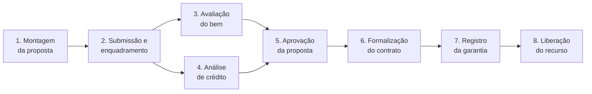
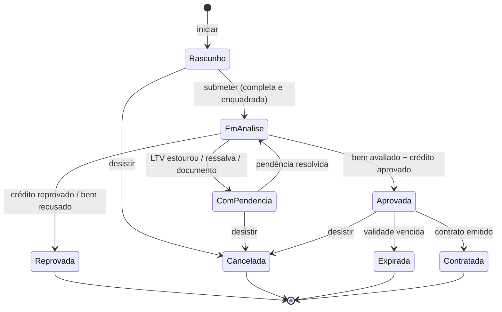
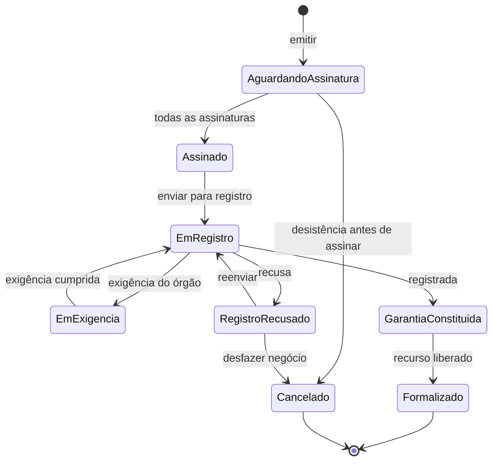

# Fluxo e eventos (event storming)

Legenda: **Comando** (alguém pede) → **Evento** (fato que aconteceu, no passado) · *Política* ("sempre que X, então Y") · [Sistema externo]

## Visão geral da jornada

Avaliação e análise de crédito correm **em paralelo**; a proposta só é aprovada quando as duas concluíram.

## Eventos por etapa

### 1. Montagem da proposta (rascunho)

| Ator | Comando | Evento |
|---|---|---|
| Proponente / vendedor | Iniciar proposta (categoria, subtipo, condição) | **PropostaIniciada** |
| Proponente | Informar participantes | **ParticipantesInformados** |
| Proponente / vendedor | Informar bem (identificação, valor de compra, vendedor) | **BemInformado** |
| Proponente | Simular e escolher condições (entrada, prazo) | **CondicoesEscolhidas** |
| Proponente | Anexar documento | **DocumentoAnexado** |
| Proponente | Desistir | **PropostaCancelada** |

O rascunho pode ficar incompleto. Categoria, subtipo e condição **não mudam** depois de iniciada (mudar = nova proposta).

### 2. Submissão e enquadramento

| Ator | Comando | Evento |
|---|---|---|
| Proponente | Submeter proposta | **PropostaSubmetida** ou rejeição imediata (incompleta / fora do enquadramento) |

*Política*: sempre que **PropostaSubmetida** → solicitar avaliação do bem **e** análise de crédito.

### 3. Avaliação do bem

| Ator | Comando / fato | Evento |
|---|---|---|
| Sistema | Solicitar avaliação | **AvaliacaoSolicitada** |
| [Avaliador / tabela] | retorno | **BemAvaliado** (valor de avaliação) ou **BemRecusadoComoGarantia** |

*Política*: sempre que **BemAvaliado** → recalcular valor de referência e LTV; se o LTV estourar → **PropostaComPendencia** (aumentar entrada ou reduzir valor).

### 4. Análise de crédito

| Ator | Comando / fato | Evento |
|---|---|---|
| Sistema | Solicitar análise | **AnaliseCreditoSolicitada** |
| [Bureau / motor] ou analista | decisão | **CreditoAprovado**, **CreditoAprovadoComRessalva** ou **CreditoReprovado** |

*Política*: sempre que **CreditoReprovado** ou **BemRecusadoComoGarantia** → **PropostaReprovada**.

### 5. Aprovação

*Política*: quando **BemAvaliado** e **CreditoAprovado** e o enquadramento continua válido → **PropostaAprovada** (com validade).
Ressalva aceita pelo proponente → **CondicoesAjustadas** e reenquadramento.
*Política*: validade vencida sem contratação → **PropostaExpirada**.

### 6. Formalização

| Ator | Comando | Evento |
|---|---|---|
| Proponente | Aceitar condições finais | **CondicoesAceitas** |
| Sistema | Emitir contrato | **ContratoEmitido** |
| Participantes (e vendedor, no imóvel) | Assinar | **ContratoAssinado** (quando todas as assinaturas exigidas existirem) |

### 7. Registro da garantia

| Ator | Comando / fato | Evento |
|---|---|---|
| Sistema | Enviar para registro | **RegistroSolicitado** |
| [Cartório / órgão de trânsito] | retorno | **GarantiaRegistrada**, **ExigenciaEmitida** ou **RegistroRecusado** |
| Analista | Cumprir exigência / reenviar | **ExigenciaCumprida** → novo **RegistroSolicitado** |

Retorno que fala de **outro bem** (identificação divergente) não é aceito como registro: vira pendência para o analista.

### 8. Liberação do recurso

*Política*: sempre que **GarantiaRegistrada** → **LiberacaoSolicitada** → **RecursoLiberado** (vendedor pago) → **ContratoFormalizado**.

> Veículo novo: é comum liberar o recurso com o gravame **solicitado** e não ainda confirmado. Ver [questões em aberto](questoes-em-aberto.md).

## Ciclo de vida da proposta

## Ciclo de vida do contrato

## Pontos de atenção (hotspots)

- **Retornos externos são fatos**, não pedidos: não se "recusa" um registro feito; ele é classificado (conforme, divergente).
- **Retornos repetidos** (mesmo protocolo) não podem gerar efeito duas vezes.
- **Avaliação abaixo do valor de compra** muda o valor de referência e pode invalidar a proposta já submetida.
- **Prazo do registro de imóvel** é longo (dias a semanas) e pode ter várias exigências; veículo é rápido.
- **Cancelamento depois da assinatura** envolve distrato e baixa da garantia — fora do escopo inicial, mas o estado existe.
