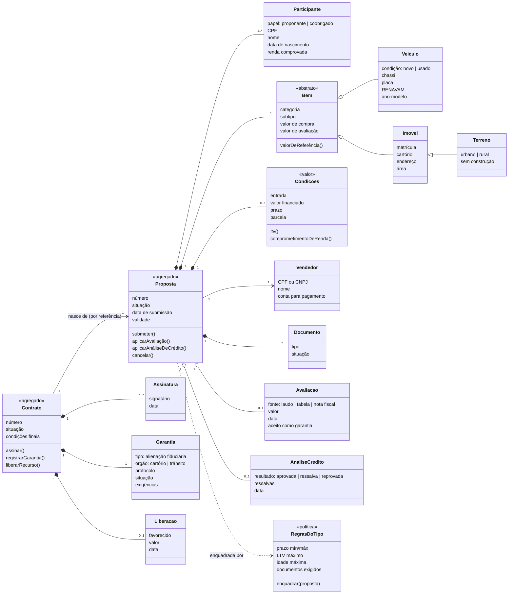

# Modelo conceitual

Diagrama de **conceitos de negócio**, sem tecnologia. Ele indica relações e responsabilidades; tipos de dado,
tabelas e classes concretas virão no espaço da solução.

> Terreno aparece como especialização de Imóvel porque compartilha identificação (matrícula) e registro (cartório);
> o que muda são as regras e os documentos. Em [questões em aberto](questoes-em-aberto.md) fica a decisão de
> mantê-lo como subtipo ou especialização.

## Agregados candidatos

### Proposta
Fronteira de consistência da **originação**: participantes, bem, condições, documentos e os resultados de avaliação e crédito
**como chegaram à proposta**.

Invariantes:
1. Categoria, subtipo e condição são fixados ao iniciar e nunca mudam.
2. Só o **rascunho** e a proposta **com pendência** aceitam alteração de dados.
3. Para submeter: tudo completo e enquadrado nas regras do tipo (C1–C8).
4. Qualquer mudança em valor de compra, entrada, prazo ou avaliação dispara novo enquadramento.
5. Só é aprovada com avaliação aceita **e** crédito aprovado, ambos válidos e posteriores à última alteração das condições.
6. Uma proposta gera **no máximo um** contrato.

### Contrato
Fronteira de consistência da **formalização e garantia**: condições finais (cópia congelada da proposta), assinaturas,
garantia e liberação. Referencia a proposta pelo identificador, não a altera.

Invariantes:
1. Condições do contrato são imutáveis após a emissão.
2. Só vai a registro com todas as assinaturas exigidas pela categoria.
3. Um retorno de registro só é aceito se a identificação do bem registrada for a do contrato; retorno repetido não tem efeito.
4. O recurso só é liberado com a garantia constituída, uma única vez, ao vendedor da proposta.

### Fora dos agregados
- **Regras do tipo** são uma **política** consultada pela proposta, não parte dela; variam por categoria/subtipo/condição.
- **Avaliação** e **Análise de crédito** são produzidas por outros contextos; a proposta guarda o **resultado** (valor, decisão, data).
- **Vendedor** e **Participante** podem vir de um cadastro de pessoas; a proposta guarda o que precisa para a decisão.

## Por que dois agregados, e não um

- A proposta muda muito e é editada por pessoas; o contrato é estável e reage a sistemas externos.
- As invariantes não se cruzam depois da emissão: nada no contrato precisa da proposta mudando junto.
- A proposta pode terminar sem contrato (reprovada, expirada, cancelada), o que é a maioria dos casos.
