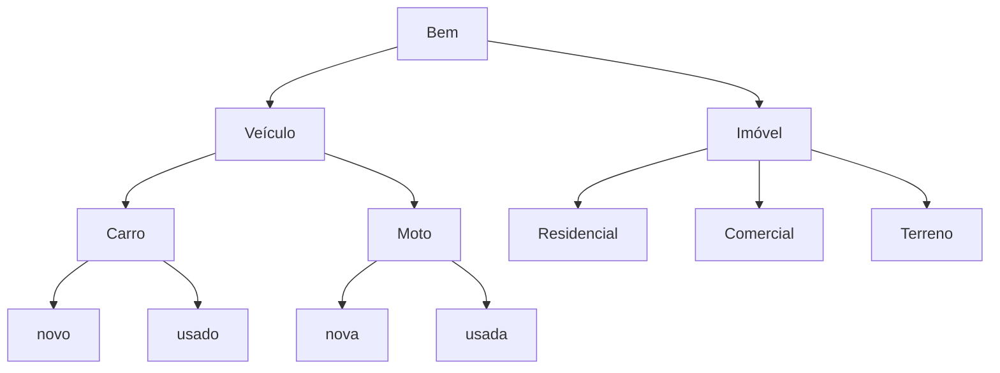

# Regras por tipo de bem

> Valores **hipotéticos**, apenas para dar forma ao modelo. Cada projeto que usar este modelo ajusta os números;
> o que importa aqui é **quais regras existem** e **em que nível elas variam**.

## Hierarquia de classificação

Uma regra é definida no nível **mais alto** em que ela não varia, e só é especializada abaixo quando muda:

- **Categoria** decide: como o bem é identificado, quem avalia, onde a garantia é registrada, documentos-base.
- **Subtipo** decide: prazo, LTV, documentos adicionais.
- **Condição** (veículo) decide: fonte da avaliação, idade, documento do bem (nota fiscal × CRLV).

## Regras comuns a todos os tipos

| # | Regra |
|---|---|
| C1 | Proposta tem **um** bem e ao menos **um** participante (o proponente). |
| C2 | Participante é pessoa maior e capaz, com CPF válido e sem duplicidade na proposta. |
| C3 | Valor financiado = valor de compra − entrada, e é maior que zero. |
| C4 | Valor financiado ≤ **LTV máximo** do tipo × valor de referência (menor entre compra e avaliação). |
| C5 | Prazo dentro do **mínimo e máximo** do tipo. |
| C6 | Parcela ≤ **30%** da renda comprovada somada dos participantes. |
| C7 | Documentos obrigatórios do tipo presentes, sem documento repetido. |
| C8 | Vendedor identificado e diferente do proponente. |
| C9 | Proposta aprovada vale **30 dias**; depois expira. |
| C10 | Recurso só é liberado com a garantia constituída (exceção possível: veículo novo, ver questões). |

## Matriz por categoria

| | **Veículo** | **Imóvel** |
|---|---|---|
| Identificação do bem | chassi, placa (se já emplacado), RENAVAM | matrícula + cartório (CNS) |
| Garantia | alienação fiduciária | alienação fiduciária |
| Registro | gravame no órgão de trânsito / sistema de gravames | averbação na matrícula, no cartório de imóveis |
| Prazo típico do registro | horas | dias a semanas, com exigências |
| Avaliação | tabela de referência (usado) ou nota fiscal (novo) | laudo de avaliação por avaliador credenciado |
| Documentos-base | identidade, comprovante de renda, comprovante de residência | identidade, comprovante de renda, comprovante de residência, estado civil, matrícula atualizada, certidões do vendedor |
| Assinam o contrato | participantes | participantes, vendedor e cônjuges (quando houver) |

## Matriz por subtipo e condição

| Regra | Carro novo | Carro usado | Moto nova | Moto usada | Imóvel residencial | Imóvel comercial | Terreno |
|---|---|---|---|---|---|---|---|
| Prazo (meses) | 12–60 | 12–60 | 12–48 | 12–36 | 60–420 | 60–240 | 60–180 |
| LTV máximo | 90% | 80% | 90% | 70% | 80% | 70% | 60% |
| Entrada mínima (decorre do LTV) | 10% | 20% | 10% | 30% | 20% | 30% | 40% |
| Idade máxima do bem **ao fim do contrato** | — | 15 anos | — | 10 anos | — | — | — |
| Fonte da avaliação | nota fiscal / preço de fábrica | tabela de referência | nota fiscal / preço de fábrica | tabela de referência | laudo | laudo | laudo |
| Documento do bem | nota fiscal ou pedido da concessionária | CRLV | nota fiscal ou pedido da concessionária | CRLV | matrícula | matrícula + habite-se | matrícula + IPTU ou ITR/CCIR (rural) |
| Restrições específicas | — | sem restrição/bloqueio no órgão de trânsito | — | sem restrição/bloqueio no órgão de trânsito | idade do proponente + prazo ≤ 80 anos e 6 meses | — | sem construção averbada; urbano ou rural define documentos |

## Exemplos de enquadramento

| Caso | Resultado |
|---|---|
| Carro usado, ano-modelo 2016, prazo 60 meses, contratado em 2026 | 2016 + 15 = 2031 = fim do contrato → **enquadra** (no limite). |
| Moto usada, compra R$ 20.000, tabela R$ 18.000, entrada R$ 4.000 | referência = 18.000; financiado 16.000 = 88,9% > 70% → **não enquadra**: entrada mínima passa a ser R$ 7.400. |
| Terreno, compra R$ 200.000, laudo R$ 210.000, financiado R$ 130.000, 120 meses | referência = 200.000; LTV 65% > 60% → **não enquadra**. |
| Imóvel residencial, proponente com 60 anos, prazo 420 meses | 60 + 35 = 95 anos → **não enquadra** pela idade; prazo máximo possível ≈ 246 meses. |
