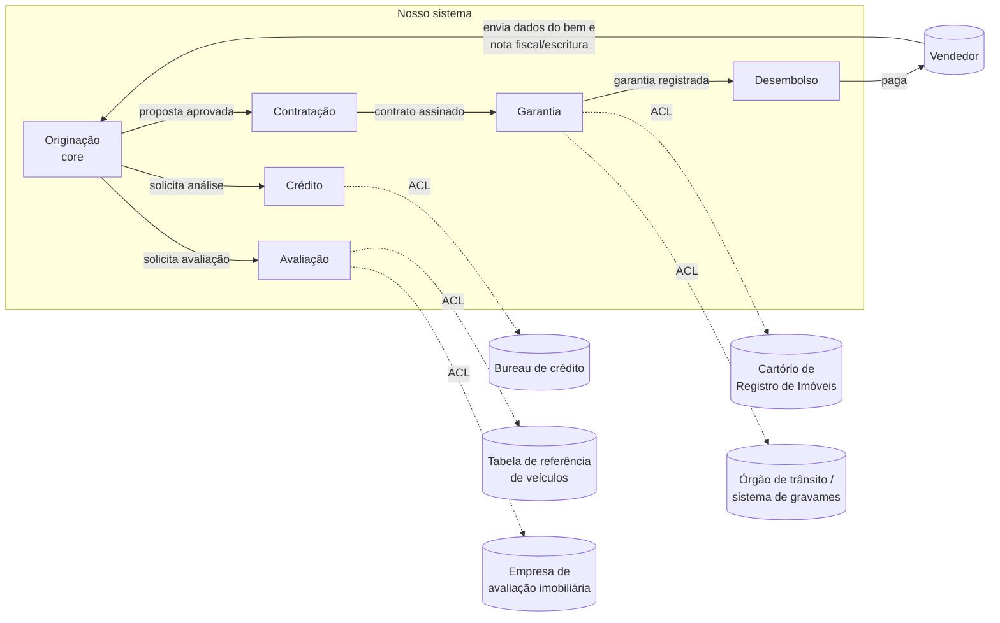

# Subdomínios e contextos delimitados

## Subdomínios

| Subdomínio | Tipo | Por quê |
|---|---|---|
| **Originação** (proposta, enquadramento por tipo de bem, condições) | **Core** | É o que diferencia o sistema: aceitar bens diferentes com regras diferentes na mesma jornada. É onde mora a variação e onde o modelo precisa ser mais rico. |
| **Análise de crédito** | Suporte | Necessária, mas a decisão é em grande parte terceirizada (bureau, motor de crédito). Nós orquestramos e guardamos o resultado. |
| **Avaliação do bem** | Suporte | Depende da categoria: laudo (imóvel/terreno), tabela de referência (veículo usado), nota fiscal/preço de fábrica (veículo novo). |
| **Formalização** (contrato e assinatura) | Suporte | Gera o instrumento a partir da proposta aprovada; regras de assinatura variam por categoria. |
| **Garantia** (alienação fiduciária e registro) | Suporte | Fala com cartório ou órgão de trânsito; tem exigências e retornos assíncronos. |
| **Liberação do recurso** | Suporte | Paga o vendedor quando a garantia está constituída. |
| **Cadastro de pessoas** | Genérico | CPF/CNPJ, endereço, renda. Pode vir de um cadastro corporativo. |
| **Documentos** | Genérico | Recebimento, guarda e conferência de arquivos. |
| **Notificações** | Genérico | Avisar participantes e vendedor. |

## Contextos delimitados (rascunho)

Cada contexto tem **sua** linguagem. "Bem", por exemplo, na Originação é *o que está sendo comprado e quanto
custa*; na Garantia é *o que está registrado em nome do credor e onde*.

| Contexto | Responsabilidade | Conceitos principais |
|---|---|---|
| **Originação** | montar a proposta, enquadrar, submeter, acompanhar até virar contrato | Proposta, Participante, Bem, Condições, Enquadramento |
| **Crédito** | decidir sobre os participantes | Análise de crédito, Renda comprovada, Ressalva |
| **Avaliação** | definir o valor de avaliação do bem | Avaliação, Laudo, Valor de avaliação |
| **Contratação** | emitir, assinar e acompanhar o contrato | Contrato, Assinatura, Formalização |
| **Garantia** | constituir e acompanhar a alienação fiduciária | Garantia, Registro, Gravame, Exigência |
| **Desembolso** | liberar o recurso ao vendedor | Liberação, Favorecido |

## Mapa de contexto

- **ACL (camada anticorrupção)**: os formatos e códigos dos sistemas externos não entram no nosso modelo; são traduzidos na fronteira.
- **Originação é a montante** dos demais contextos internos: os outros recebem dela o que precisam e respondem com fatos (análise concluída, bem avaliado, garantia registrada).
- Os retornos de cartório, órgão de trânsito e avaliador são **assíncronos** e podem chegar repetidos ou fora de ordem.
